# LAPORAN PRAKTIKUM PEMROGRAMAN BERBASIS OBJEK

| Informasi Praktikan | Keterangan |
| :--- | :--- |
| **Nama** | Ridho Sachlan |
| **NPM** | 4525210066 |
| **Kelas** | A |
| **Mata Kuliah** | Pemrograman Berbasis Objek (PBO) |
| **Pertemuan** | 10 - Exception Handling dan Pemrograman Defensif |
| **Tanggal** | Kamis, 5 November 2026 |

---

## 1. Implementasi Java

### 1.1. File: `PerpustakaanException.java`

**Penjelasan Kode:**
> Kelas induk untuk semua exception di perpustakaan. Diturunkan dari `RuntimeException` (unchecked), jadi tidak perlu `throws` di setiap method. Dengan induk ini, semua error domain bisa ditangkap sekaligus lewat satu `catch (PerpustakaanException e)`.

**Bukti Eksekusi (Screenshot):**
- **Before** :

   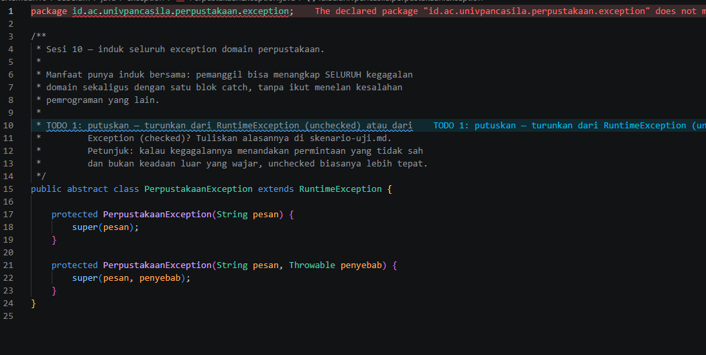
  
- **After** :

   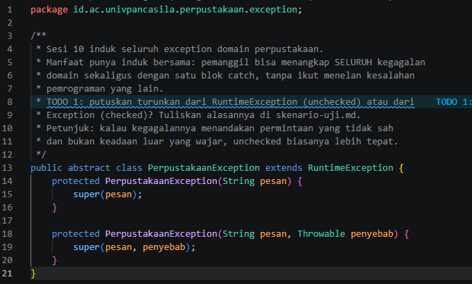

### 1.2. File: `BukuTidakDitemukanException.java`

**Penjelasan Kode:**
> Dilempar kalau ISBN buku tidak ada di katalog. Exception ini menyimpan `isbn` sebagai atribut dan bisa diambil lewat `getIsbn()`, jadi datanya bisa dipakai lagi, tidak hanya sebagai teks pesan.

**Bukti Eksekusi (Screenshot):**
- **Before** :
  
   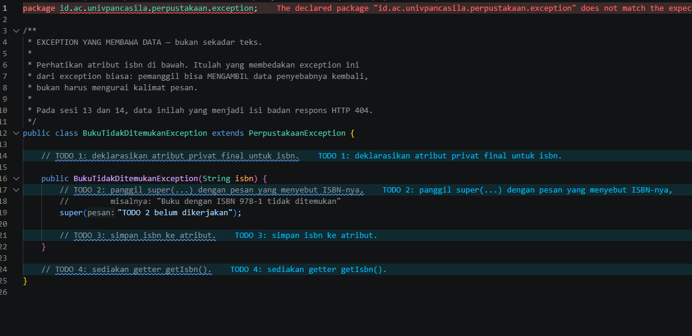
  
- **After** :
  
   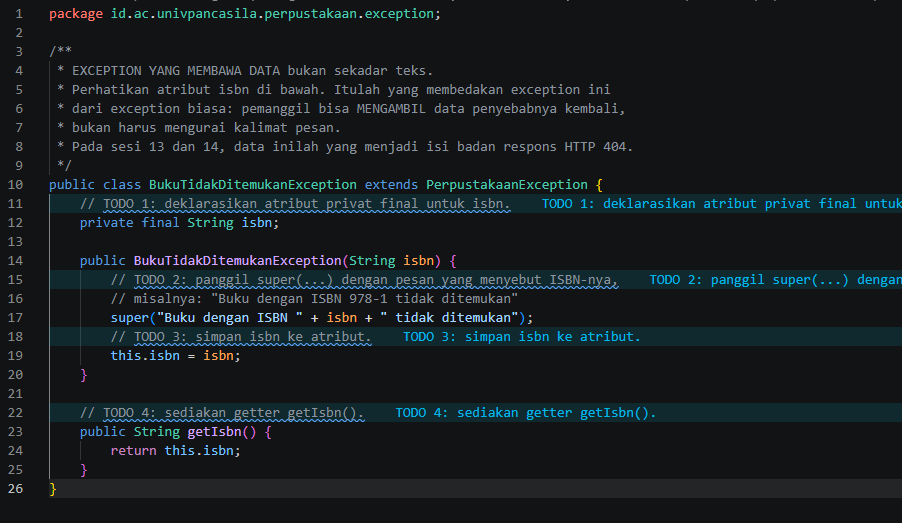

### 1.3. File: `AnggotaTidakDitemukanException.java`

**Penjelasan Kode:**
> Dilempar kalau ID anggota belum terdaftar. Menyimpan `idAnggota` dan punya getter `getIdAnggota()`.

**Bukti Eksekusi (Screenshot):**
- **Before** :
  
  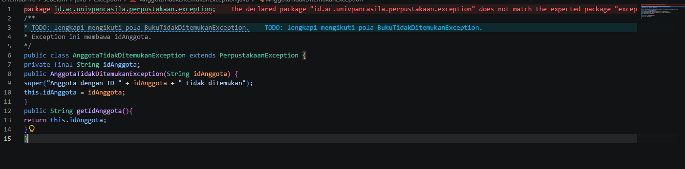
 
- **After** :
  
  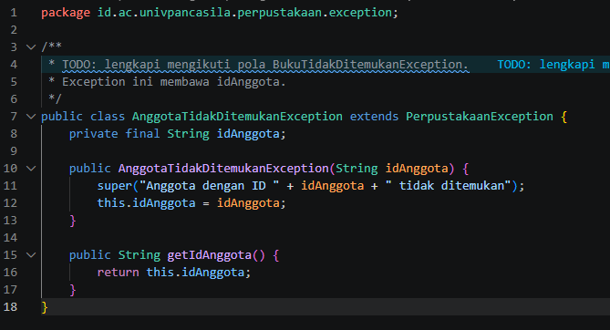

### 1.4. File: `BukuSedangDipinjamException.java`

**Penjelasan Kode:**
> Dilempar kalau stok buku habis. Menyimpan dua data, yaitu `isbn` dan `judul`, supaya pesan ke pengguna lebih jelas.

**Bukti Eksekusi (Screenshot):**
- **Before** :
  
   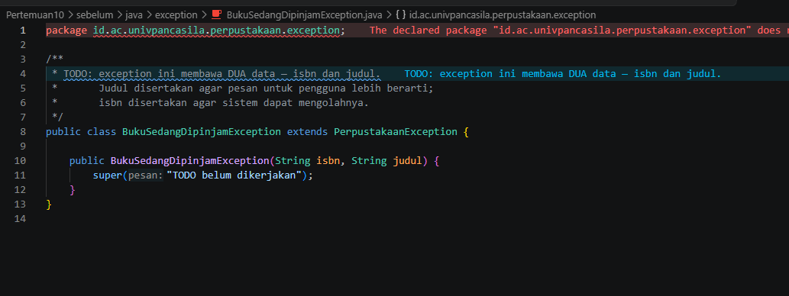
 
- **After** :
  
   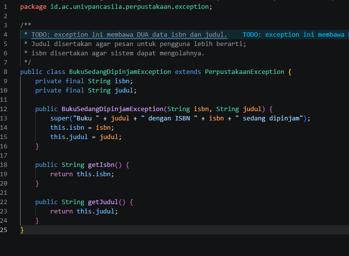

### 1.5. File: `BatasPinjamTerlampauiException.java`

**Penjelasan Kode:**
> Dilempar kalau anggota sudah meminjam sampai batas maksimal (3 buku). Menyimpan `idAnggota` dan `batas`.

**Bukti Eksekusi (Screenshot):**
- **Before** :
  
  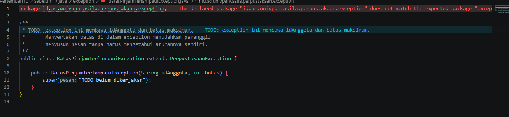
  
- **After** :
  
  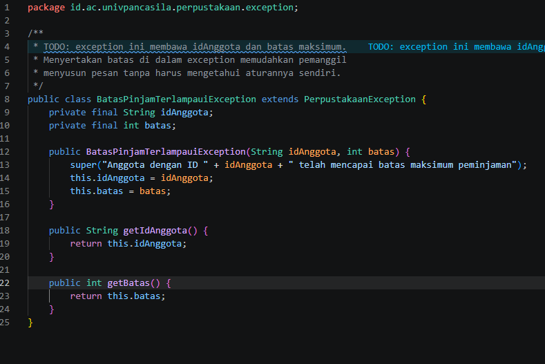

### 1.6. File: `LibraryServiceKotor.java`

**Penjelasan Kode:**
> Versi awal yang masih berantakan, sengaja tidak dihapus untuk pembanding. Method `pinjam()` punya `if` bersarang 4 tingkat dan setiap kegagalan hanya `return false`, sehingga tidak ketahuan penyebabnya. Di sini file hanya dipindah ke package `service` di proyek Maven.

**Bukti Eksekusi (Screenshot):**
- **Before** :
  
   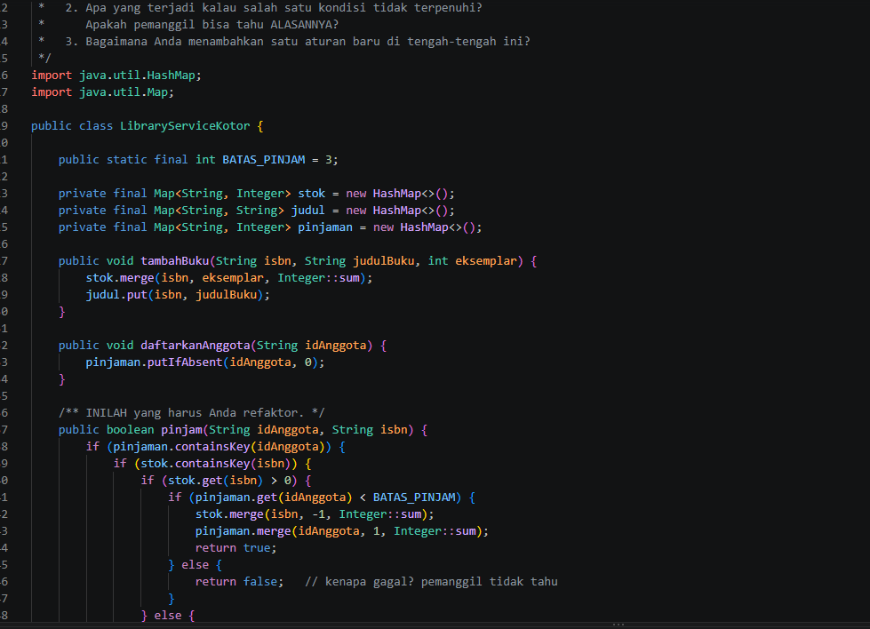
  
- **After** :
  
  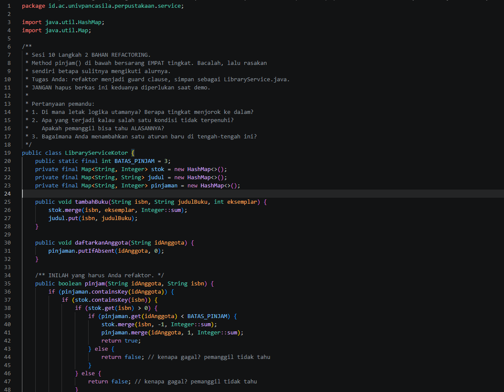

### 1.7. File: `LibraryService.java`

**Penjelasan Kode:**
> Hasil refactor `LibraryServiceKotor` memakai guard clause. Setiap kondisi yang salah dicek di awal dan langsung melempar exception yang sesuai (anggota, buku, stok, batas pinjam). Hasilnya `if` tidak lagi bersarang (dari 4 tingkat jadi 1) dan pemanggil tahu alasan gagalnya.

### 1.8. File: `PerpustakaanService.java`

**Penjelasan Kode:**
> Berisi menu input konsol supaya program tidak berhenti karena stack trace. Input kosong, huruf saat diminta angka, dan angka 0 atau negatif sudah dicek dan menampilkan pesan error. Pada `pinjamBuku()`, semua error domain ditangkap dengan satu `catch (PerpustakaanException e)`, lalu `instanceof` dipakai untuk mengambil data khusus tiap exception (isbn, id anggota, judul, atau batas).

**Bukti Eksekusi (Screenshot):**
- **Source code**:
  
  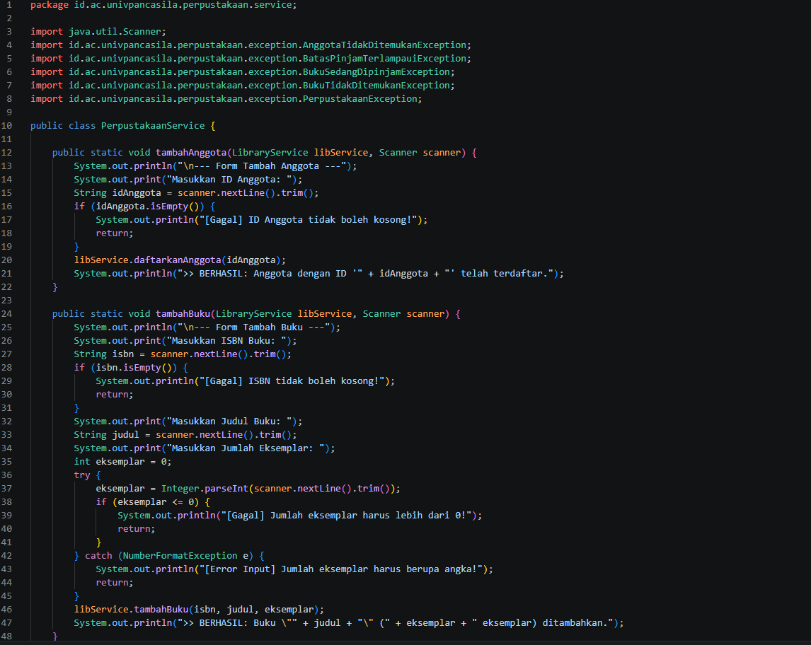

### 1.9. File: `Main.java`

**Penjelasan Kode:**
> Program utama yang menampilkan menu (tambah buku, tambah anggota, pinjam buku, keluar). Setelah keluar, daftar buku diekspor ke `laporan_buku.txt` memakai try-with-resources, jadi file otomatis tertutup walaupun terjadi error saat menulis.

### Output

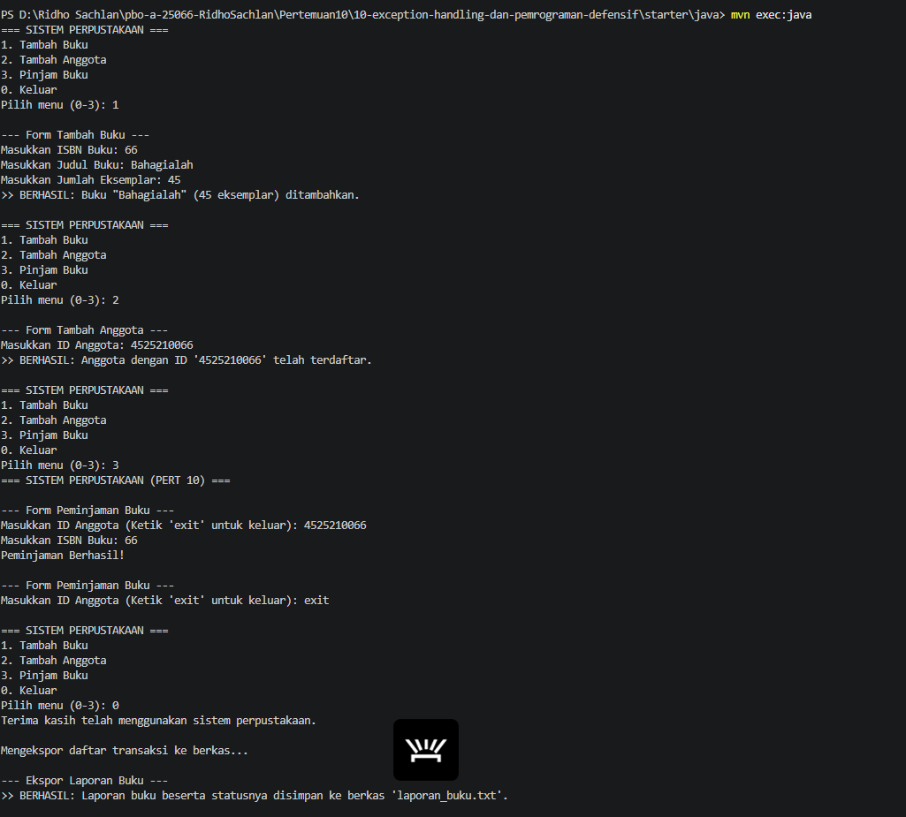

---

## 2. Implementasi PHP

### 2.1. File: `PerpustakaanException.php`

**Penjelasan Kode:**
> Kelas induk exception di PHP, diturunkan dari `RuntimeException`. PHP tidak punya checked exception, jadi semuanya setara unchecked.

**Bukti Eksekusi (Screenshot):**
- **Source code**:
  
  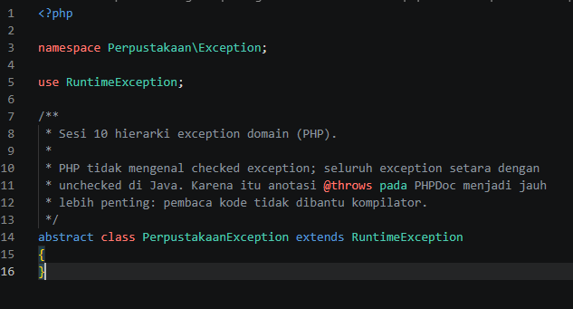

### 2.2. File: `BukuTidakDitemukanException.php`

**Penjelasan Kode:**
> Dilempar kalau ISBN tidak ada. Menyimpan `$isbn` sebagai properti `readonly` dan punya getter `getIsbn()`.

**Bukti Eksekusi (Screenshot):**
- **Source code**:
  
   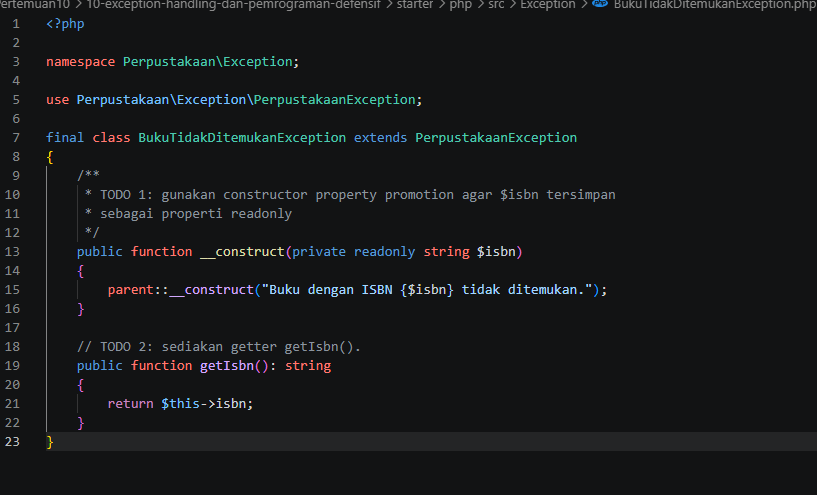

### 2.3. File: `AnggotaTidakDitemukanException.php`

**Penjelasan Kode:**
> Dilempar kalau ID anggota belum terdaftar. Menyimpan `$idAnggota` dan punya getter `getIdAnggota()`.

**Bukti Eksekusi (Screenshot):**
- **Source code**:
  
   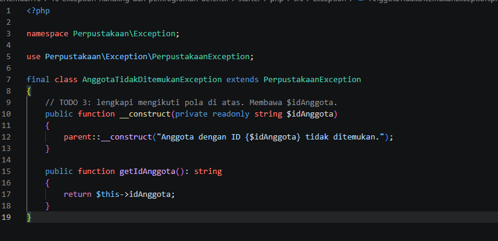

### 2.4. File: `BukuSedangDipinjamException.php`

**Penjelasan Kode:**
> Dilempar kalau stok buku habis. Menyimpan `$isbn` dan `$judul`.

**Bukti Eksekusi (Screenshot):**
- **Source code**:
  
  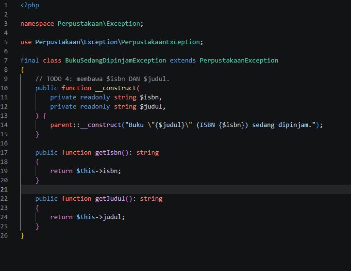

### 2.5. File: `BatasPinjamTerlampauiException.php`

**Penjelasan Kode:**
> Dilempar kalau anggota sudah mencapai batas pinjam. Menyimpan `$idAnggota` dan `$batas`.

**Bukti Eksekusi (Screenshot):**
- **Source code**:
  
   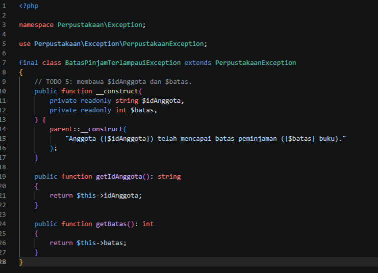

### 2.6. File: `LibraryServiceKotor.php`

**Penjelasan Kode:**
> Versi PHP yang masih berantakan: `pinjam()` punya `if` bersarang 4 tingkat dan hanya `return false` tanpa alasan.

**Bukti Eksekusi (Screenshot):**
- **Source code**:

   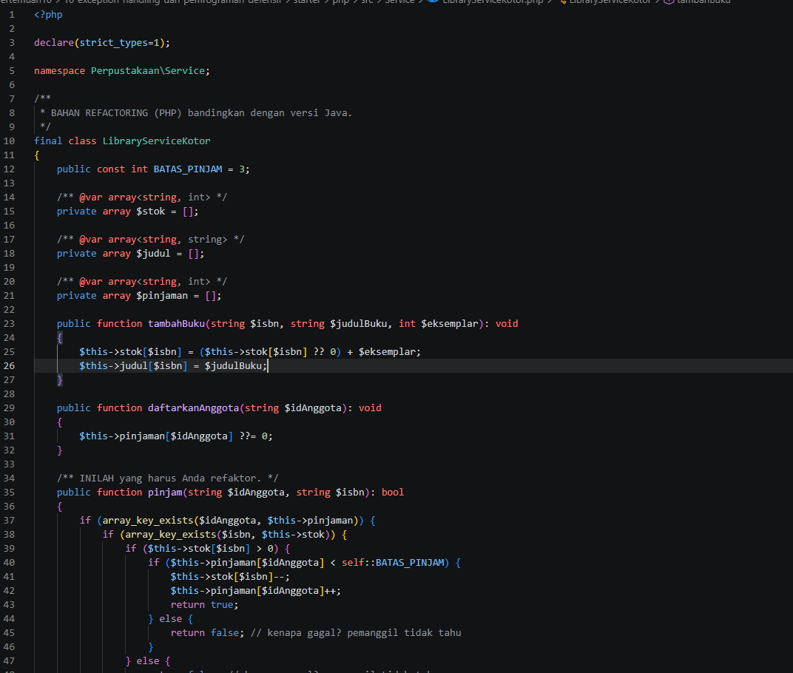

### 2.7. File: `LibraryService.php`

**Penjelasan Kode:**
> Hasil refactor dengan guard clause. `pinjam()` mengecek anggota, ISBN, stok, dan batas pinjam secara berurutan, dan langsung melempar exception kalau ada yang salah. Return type jadi `void` dan `@throws` ditulis sebagai dokumentasi.

**Bukti Eksekusi (Screenshot):**
- **Source code**:

   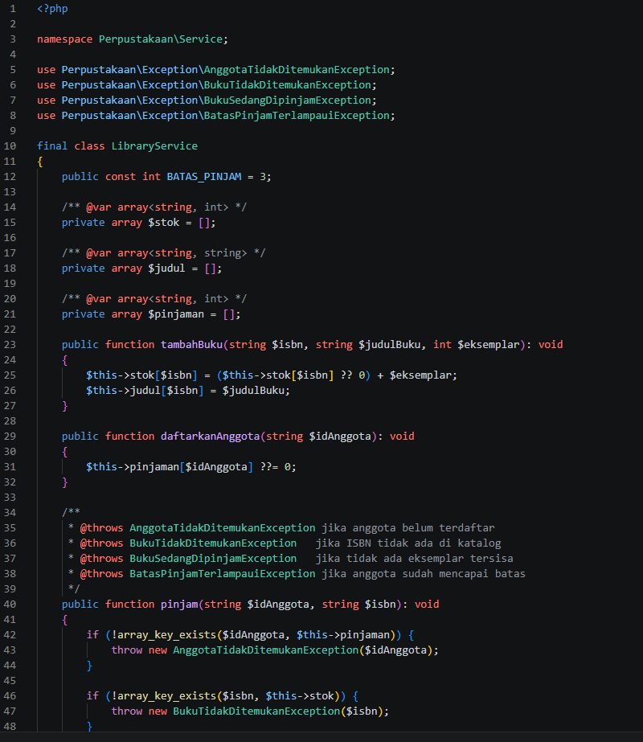

### 2.8. File: `Main.php`

**Penjelasan Kode:**
> Menjalankan 7 percobaan peminjaman (berhasil dan gagal), masing-masing dibungkus `try` dengan satu `catch (PerpustakaanException $e)`. Lalu laporan buku ditulis ke `laporan_buku.txt`. Karena PHP tidak punya try-with-resources, file ditutup manual dengan `fclose()` di blok `finally`.

**Bukti Eksekusi (Screenshot):**
- Tidak ada screenshot khusus, hasilnya bisa dilihat di bagian Output.

### Output

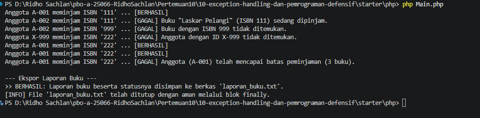

---

## 3. Kesimpulan

 Semua exception punya induk yang sama sehingga bisa ditangkap dengan satu `catch`. Method `pinjam()` juga dirapikan dari `if` bersarang menjadi guard clause, sehingga lebih mudah dibaca dan alasan gagalnya jelas. Input yang salah ditangani dengan pesan biasa tanpa membuat program berhenti. Untuk file, Java memakai try-with-resources sedangkan PHP memakai `finally`.
