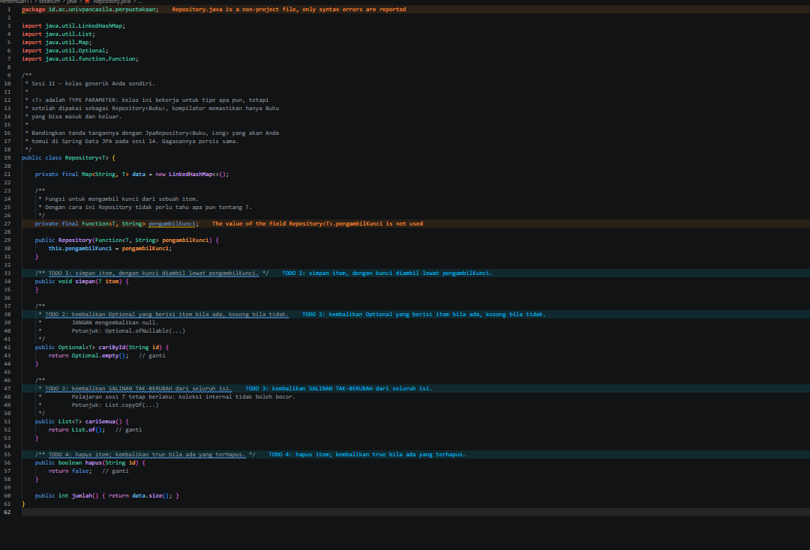
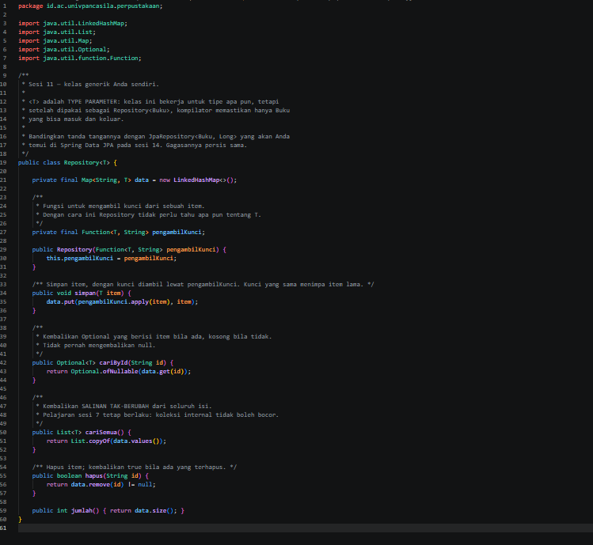
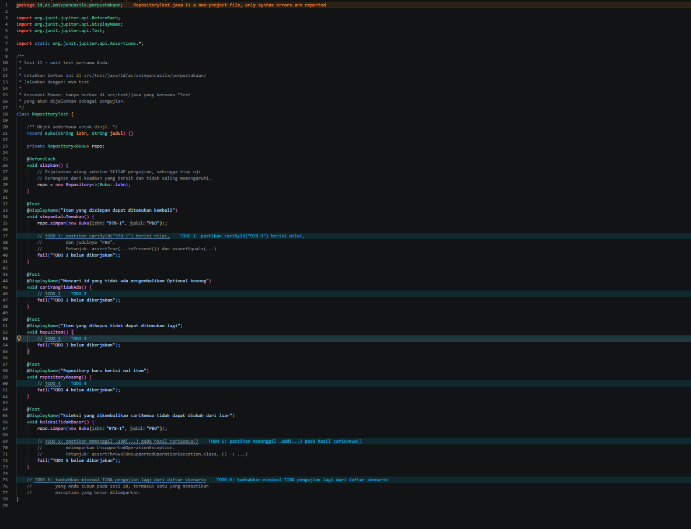
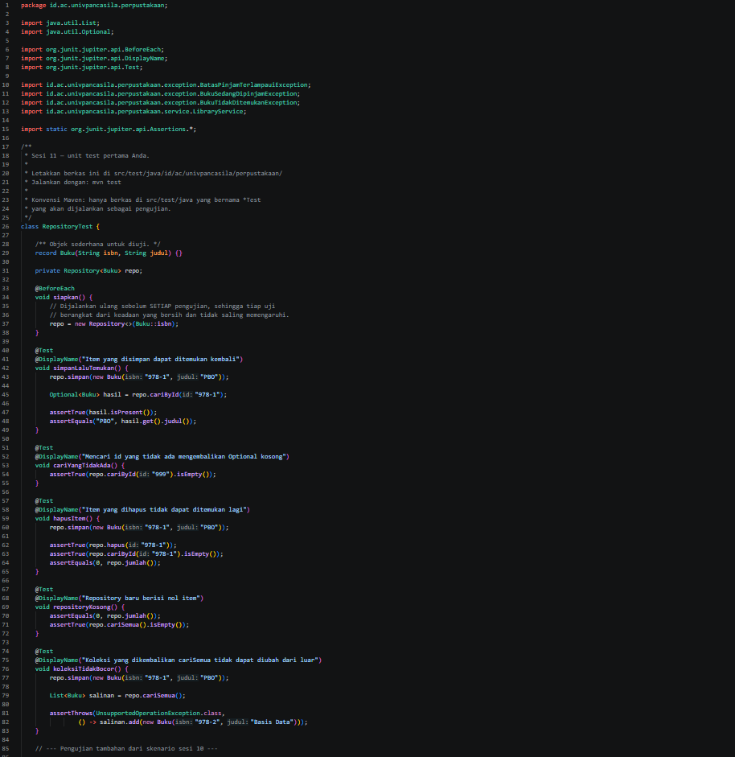
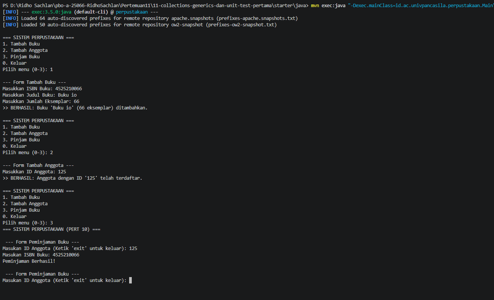
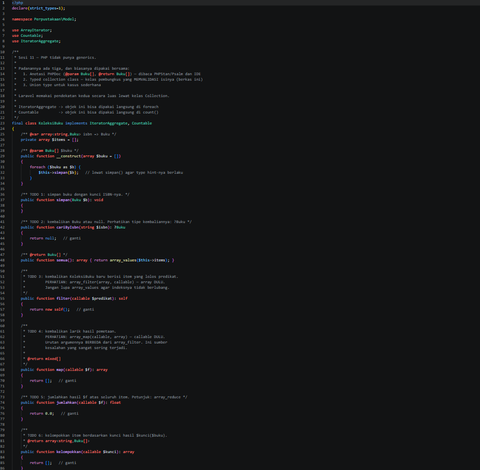
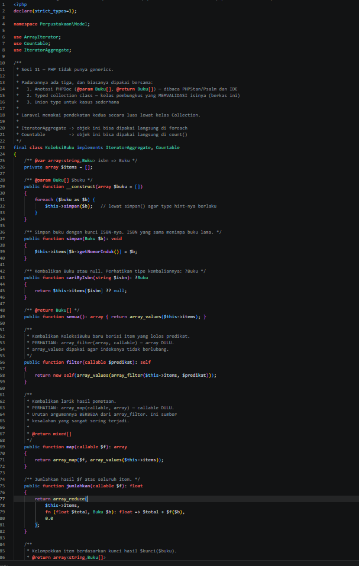
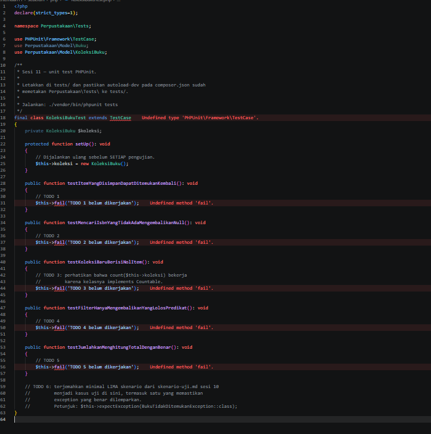
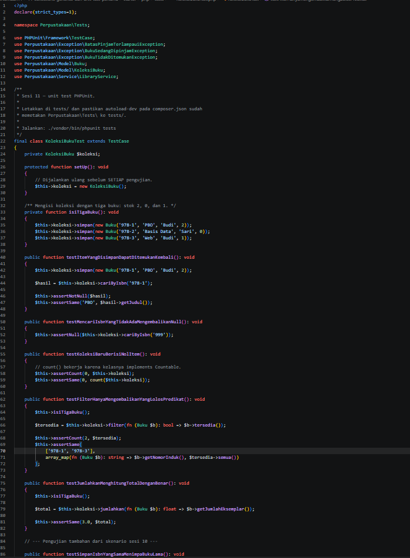
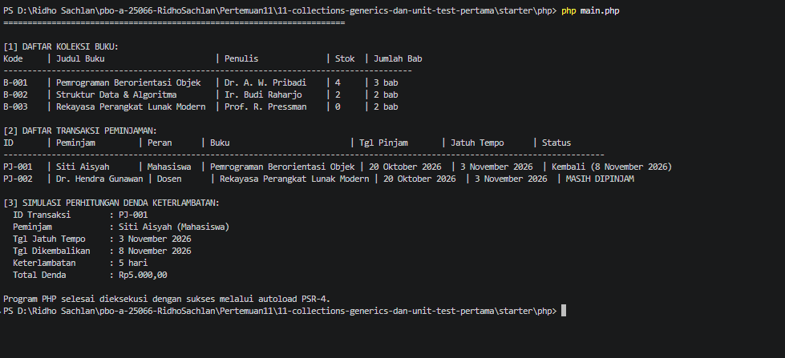

# LAPORAN PRAKTIKUM PEMROGRAMAN BERBASIS OBJEK

| Informasi Praktikan | Keterangan |
| :--- | :--- |
| **Nama** | Ridho Sachlan |
| **NPM** | 4525210066 |
| **Kelas** | A |
| **Mata Kuliah** | Pemrograman Berbasis Objek (PBO) |
| **Pertemuan** | 11 - Collections, Generics, dan Unit Test Pertama |
| **Tanggal** | Kamis, 12 November 2026 |

---

## 1. Implementasi Java

### 1.1. File: `Repository.java`

**Penjelasan Kode:**
> Kelas generik `Repository<T>` yang bisa menyimpan tipe apa pun. Data disimpan di `LinkedHashMap<String, T>` sehingga pencarian lewat kunci tidak perlu perulangan dan urutan simpan tetap terjaga. Kunci tiap item diambil lewat `Function<T, String>` yang diberikan di constructor, jadi `Repository` tidak perlu tahu isi `T`. `simpan()` memakai `put()` sehingga kunci yang sama menimpa item lama. `cariById()` mengembalikan `Optional<T>` (lewat `Optional.ofNullable`), bukan `null`. `cariSemua()` mengembalikan `List.copyOf(...)` sehingga koleksi internal tidak bocor dan tidak bisa diubah dari luar. `hapus()` mengembalikan `true` kalau ada item yang terhapus.

**Bukti Eksekusi (Screenshot):**
- **Before** : 

- **After** : 

### 1.2. File: `RepositoryTest.java`

**Penjelasan Kode:**
> Kelas uji JUnit 5 yang diletakkan di `src/test/java` dengan struktur package yang sama seperti `src/main/java`. `@BeforeEach` membuat `Repository` baru sebelum setiap uji supaya antar uji tidak saling memengaruhi. Ada 11 kasus uji: 7 untuk `Repository` (simpan lalu temukan, id tidak ada mengembalikan `Optional` kosong, hapus item, repository kosong, `cariSemua()` tidak bisa diubah dari luar, kunci sama menimpa item lama, hapus id yang tidak ada mengembalikan `false`) dan 4 untuk `LibraryService` (peminjaman sah mengurangi stok, serta `pinjam()` melempar `BukuTidakDitemukanException`, `BatasPinjamTerlampauiException`, dan `BukuSedangDipinjamException` sesuai skenario sesi 10).

**Bukti Eksekusi (Screenshot):**
- **Before** : 

- **After** : 

### 1.3. File: `Main.java` dan `PerpustakaanService.java`

**Penjelasan Kode:**
> menampilkan menu tambah buku, tambah anggota, dan pinjam buku. `PerpustakaanService.java` berisi form input konsol yang menangkap semua error domain lewat satu `catch (PerpustakaanException e)`.

### Output

---

## 2. Implementasi PHP

### 2.1. File: `KoleksiBuku.php`

**Penjelasan Kode:**
> PHP tidak punya generics, jadi padanannya adalah typed collection class. `KoleksiBuku` membungkus array `isbn => Buku` dan hanya menerima `Buku` lewat type hint pada `simpan(Buku $b)`. Kelas ini mengimplementasikan `IteratorAggregate` (bisa dipakai di `foreach`) dan `Countable` (bisa dipakai di `count()`). `cariByIsbn()` memakai tipe nullable `?Buku` dan operator `??`. Operasi fungsional yang tersedia: `filter()` (`array_filter`, array dulu lalu callable, dibungkus `array_values` agar indeks tidak berlubang), `map()` (`array_map`, callable dulu lalu array), `jumlahkan()` (`array_reduce`), dan `kelompokkan()` untuk mengelompokkan item berdasarkan kunci tertentu.

**Bukti Eksekusi (Screenshot):**
- **Before** : 

- **After** : 

### 2.2. File: `KoleksiBukuTest.php`

**Penjelasan Kode:**
> Kelas uji PHPUnit di folder `tests/` dengan namespace `Perpustakaan\Tests`. Method `setUp()` membuat `KoleksiBuku` baru sebelum setiap uji. Ada 12 kasus uji: simpan lalu temukan, ISBN tidak ada mengembalikan `null`, koleksi baru berisi nol item, `filter()` hanya mengembalikan yang lolos predikat, `jumlahkan()` menghitung total dengan benar, ISBN sama menimpa buku lama, `filter()` menghasilkan indeks berurutan, `map()` mengembalikan daftar judul, `kelompokkan()` berdasarkan penulis, serta tiga uji exception pada `LibraryService` (ISBN tidak terdaftar, batas pinjam terlampaui, dan buku sedang dipinjam).

**Bukti Eksekusi (Screenshot):**
- **Before** : 

- **After** : 

### 2.3. File: `main.php`

**Penjelasan Kode:**
> Program memuat kelas lewat autoload PSR-4 Composer, lalu menampilkan daftar koleksi buku, daftar transaksi peminjaman, dan simulasi perhitungan denda keterlambatan.

### Output

---

## 3. Kesimpulan

Struktur data manual diganti dengan koleksi yang tepat: `Map` untuk pencarian lewat kunci tanpa perulangan, dan `List` untuk daftar berurutan. Kelas generik `Repository<T>` di Java memastikan hanya satu jenis objek yang bisa masuk dan keluar, dan padanannya di PHP adalah typed collection `KoleksiBuku`. Pencarian dibuat lebih aman karena mengembalikan `Optional` di Java dan tipe nullable `?Buku` di PHP, bukan `null` mentah. Unit test dengan JUnit 5 dan PHPUnit mengubah skenario kegagalan sesi 10 menjadi kasus uji yang bisa dijalankan ulang kapan saja lewat `mvn test` dan `./vendor/bin/phpunit tests`.