# LAPORAN PRAKTIKUM PEMROGRAMAN BERBASIS OBJEK

| Informasi Praktikan | Keterangan |
| :--- | :--- |
| **Nama** | Ridho Sachlan |
| **NPM** | 4525210066 |
| **Kelas** | A |
| **Mata Kuliah** | Pemrograman Berbasis Objek (PBO) |
| **Pertemuan** | 13 — FRAMEWORK LARAVEL |
| **Tanggal** | *Kamis, 26 November 2026* |

---

## 1. Panduan Instalasi

**Kebutuhan:** PHP >= 8.2, Composer, Node.js & NPM, serta database (MySQL/SQLite).

1. Clone atau ekstrak project, lalu masuk ke folder project:
   ```bash
   cd example--app
   ```
2. Install dependensi PHP:
   ```bash
   composer install
   ```
3. Salin file environment:
   ```bash
   cp .env.example .env
   ```
4. Generate application key:
   ```bash
   php artisan key:generate
   ```
5. Atur koneksi database pada file `.env` (`DB_CONNECTION`, `DB_DATABASE`, `DB_USERNAME`, `DB_PASSWORD`), lalu buat database-nya jika memakai MySQL.
6. Jalankan migrasi sekaligus seeder untuk membuat tabel dan data awal:
   ```bash
   php artisan migrate --seed
   ```
7. (Opsional) Install dependensi frontend:
   ```bash
   npm install
   ```

---

## 2. Panduan Running Laravel

1. Jalankan server pengembangan:
   ```bash
   php artisan serve
   ```
2. Aplikasi dapat diakses pada `http://127.0.0.1:8000`, sehingga base URL API adalah:
   ```
   http://127.0.0.1:8000/api
   ```
3. Uji endpoint menggunakan aplikasi API client seperti Thunder Client, Postman, atau Insomnia.
4. (Opsional) Jalankan pengujian otomatis:
   ```bash
   php artisan test
   ```

---

## 3. Screenshot Route (`routes/api.php`)

| Resource | Method | Endpoint | Controller |
| :--- | :--- | :--- | :--- |
| Buku | GET | `/api/buku/get` | `BukuController@index` |
| Buku | POST | `/api/buku/create` | `BukuController@store` |
| Buku | PATCH | `/api/buku/update/{id}` | `BukuController@update` |
| Buku | DELETE | `/api/buku/delete/{id}` | `BukuController@destroy` |
| Anggota | GET | `/api/anggota/get` | `AnggotaController@index` |
| Anggota | POST | `/api/anggota/create` | `AnggotaController@store` |
| Anggota | PATCH | `/api/anggota/update/{id}` | `AnggotaController@update` |
| Anggota | DELETE | `/api/anggota/delete/{id}` | `AnggotaController@destroy` |
| Pinjam Buku | GET | `/api/pinjam-buku/get` | `PeminjamanBukuController@index` |
| Pinjam Buku | POST | `/api/pinjam-buku/create` | `PeminjamanBukuController@store` |
| Pinjam Buku | PATCH | `/api/pinjam-buku/update/{id}` | `PeminjamanBukuController@update` |
| Pinjam Buku | DELETE | `/api/pinjam-buku/delete/{id}` | `PeminjamanBukuController@destroy` |

---

## 4. Percobaan Hasil API per Route

### 4.1. Route Buku

**GET `/api/buku/get`**

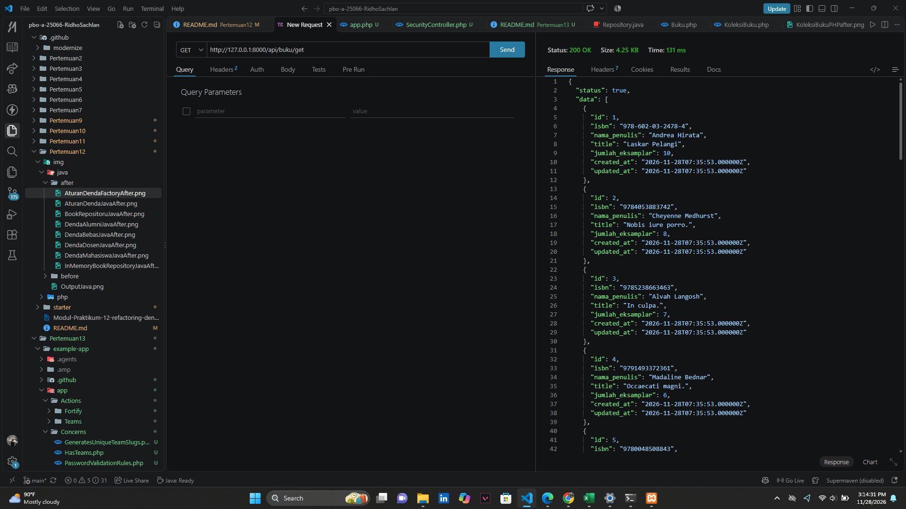

**POST `/api/buku/create`**

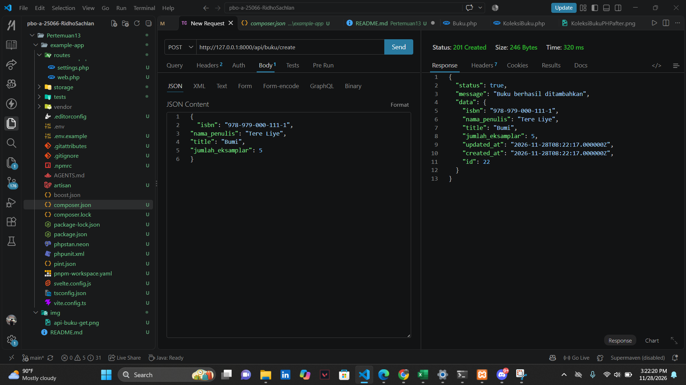

**PATCH `/api/buku/update/{id}`**

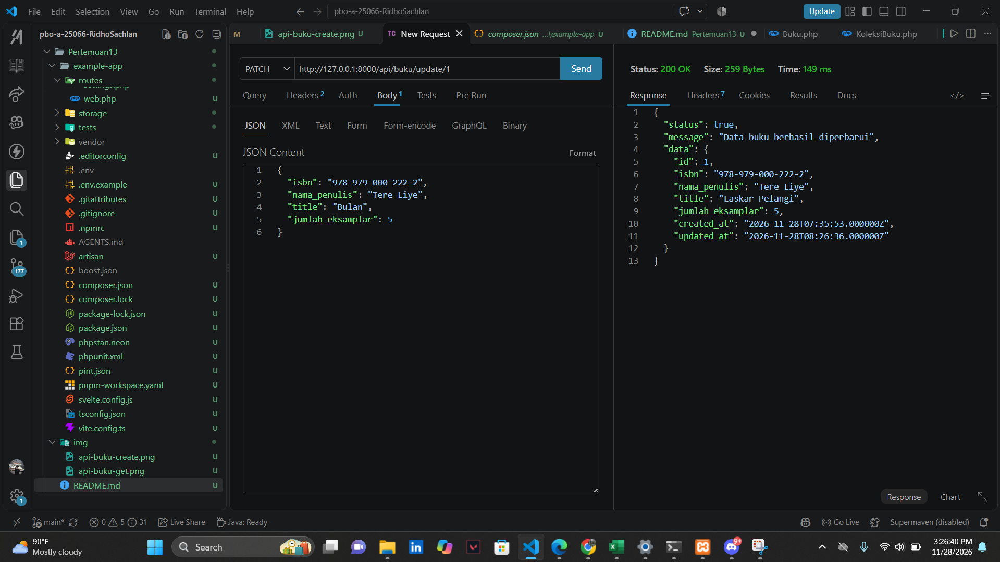

**DELETE `/api/buku/delete/{id}`**

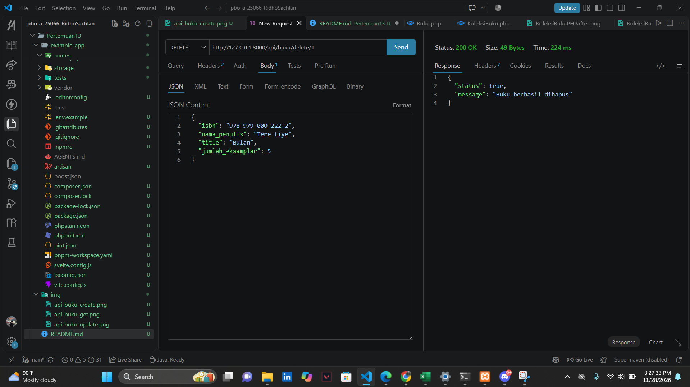

### 4.2. Route Anggota

**GET `/api/anggota/get`**

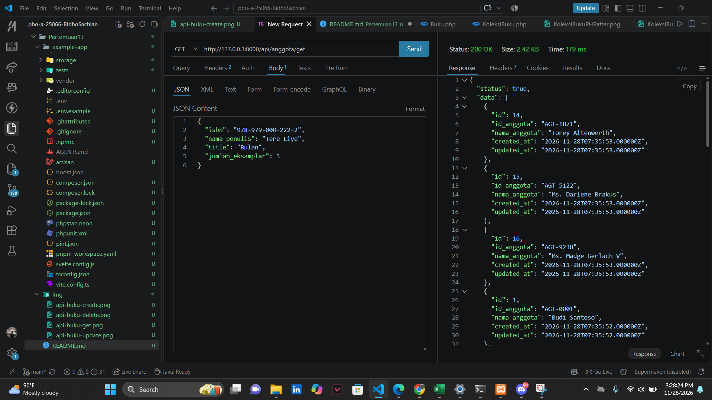

**POST `/api/anggota/create`**

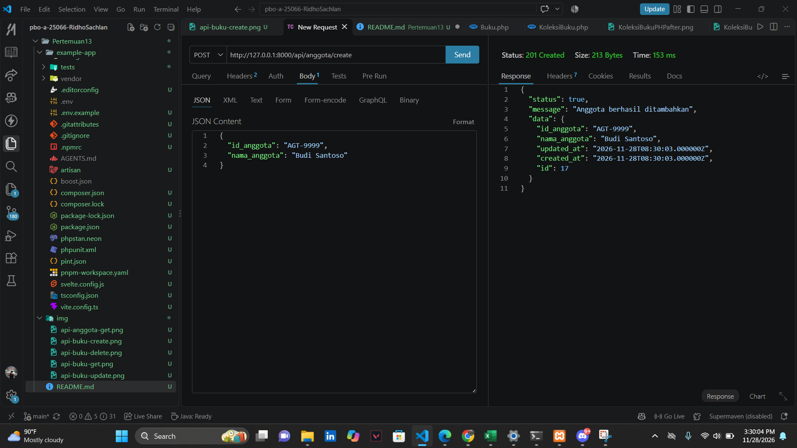

**PATCH `/api/anggota/update/{id}`**

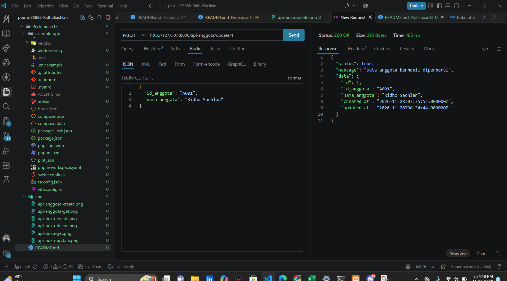

**DELETE `/api/anggota/delete/{id}`**

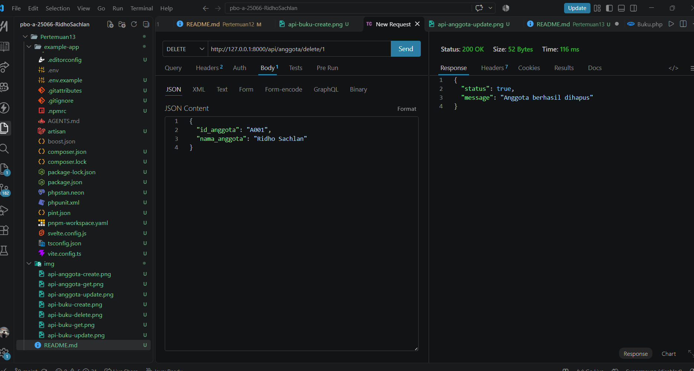

### 4.3. Route Pinjam Buku

**GET `/api/pinjam-buku/get`**

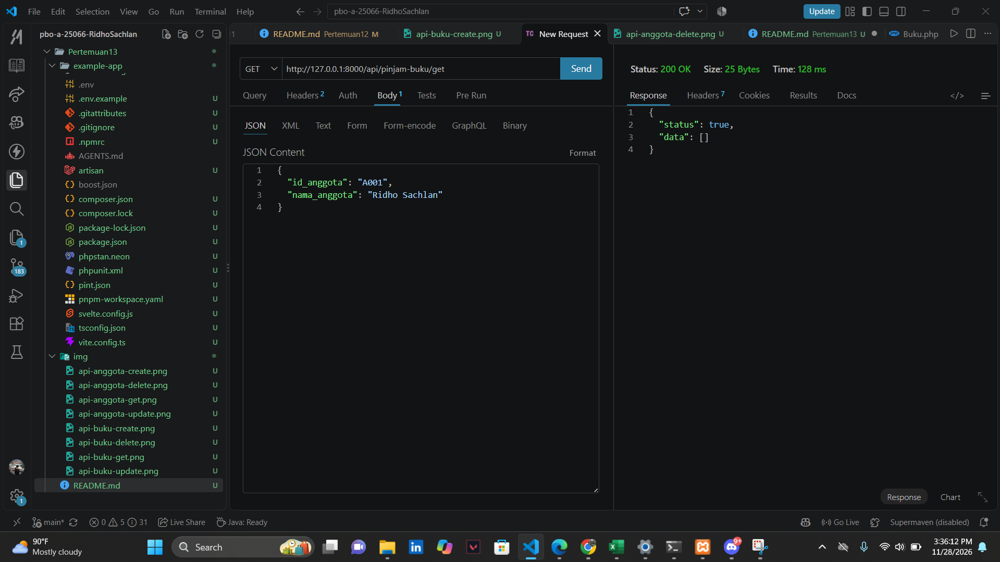

**POST `/api/pinjam-buku/create`**

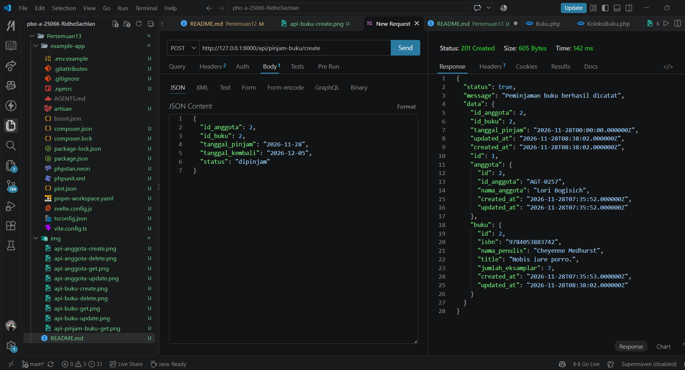

**PATCH `/api/pinjam-buku/update/{id}`**

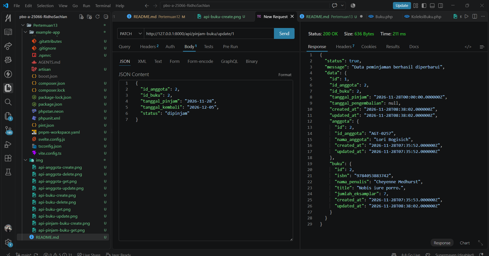

**DELETE `/api/pinjam-buku/delete/{id}`**

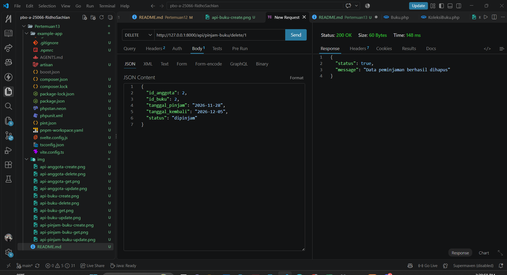