# LAPORAN PRAKTIKUM PEMROGRAMAN BERBASIS OBJEK

| Informasi Praktikan | Keterangan |
| :--- | :--- |
| **Nama** | Ridho Sachlan |
| **NPM** | 4525210066 |
| **Kelas** | A |
| **Mata Kuliah** | Pemrograman Berbasis Objek (PBO) |
| **Pertemuan** | 07 - Pemodelan relasi objek dan uml |
| **Tanggal** | Kamis, 15 Oktober 2026 |

---

## 1. Implementasi Java

### 1.1. File: `Main.java`

**Penjelasan Kode:**
> Menjadi entry point aplikasi untuk menguji seluruh pemodelan relasi objek sistem perpustakaan.menginisialisasi entitas `Jurusan`, memuat daftar `Buku` menggunakan konsep komposisi, mendaftarkan `Anggota` (agregasi), serta menguji alur peminjaman dan pengembalian buku melalui `PerpustakaanService`.

**Bukti Eksekusi (Screenshot):**
- **Before** : 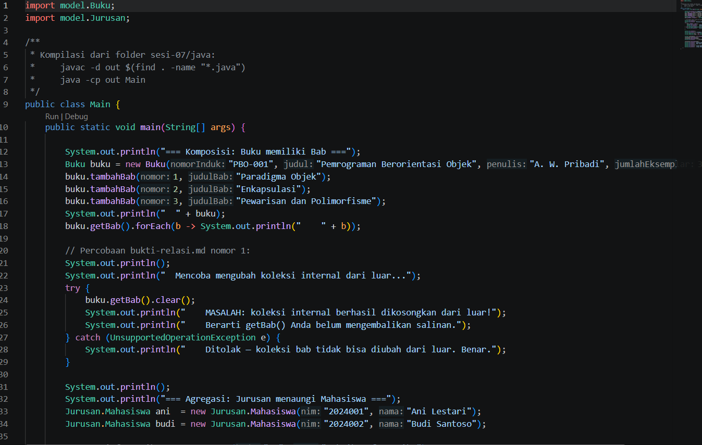
- **After**  : 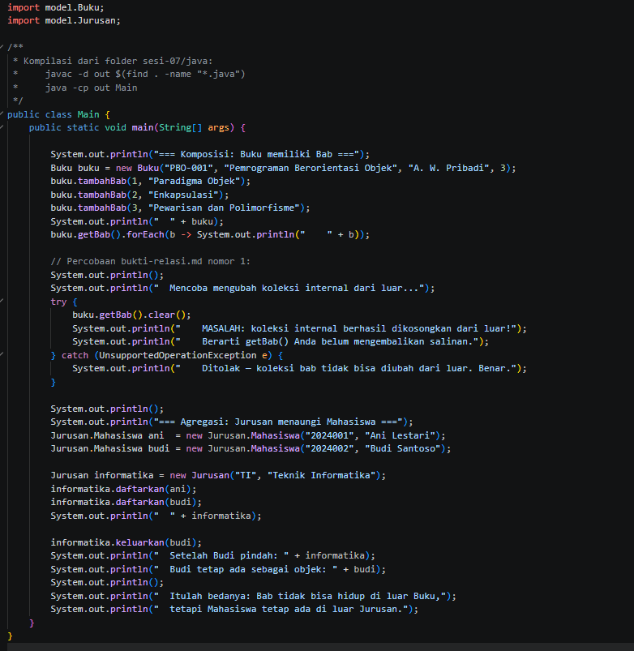

### 1.2. File: `Buku.java`

**Penjelasan Kode:**
> Kelas model yang merepresentasikan data buku perpustakaan. Mengimplementasikan enkapsulasi dengan atribut `kode`, `judul`, `penulis`, dan status `dipinjam`. Menyediakan *getter/setter* serta validasi status peminjaman.

**Bukti Eksekusi (Screenshot):**
- **Before** : 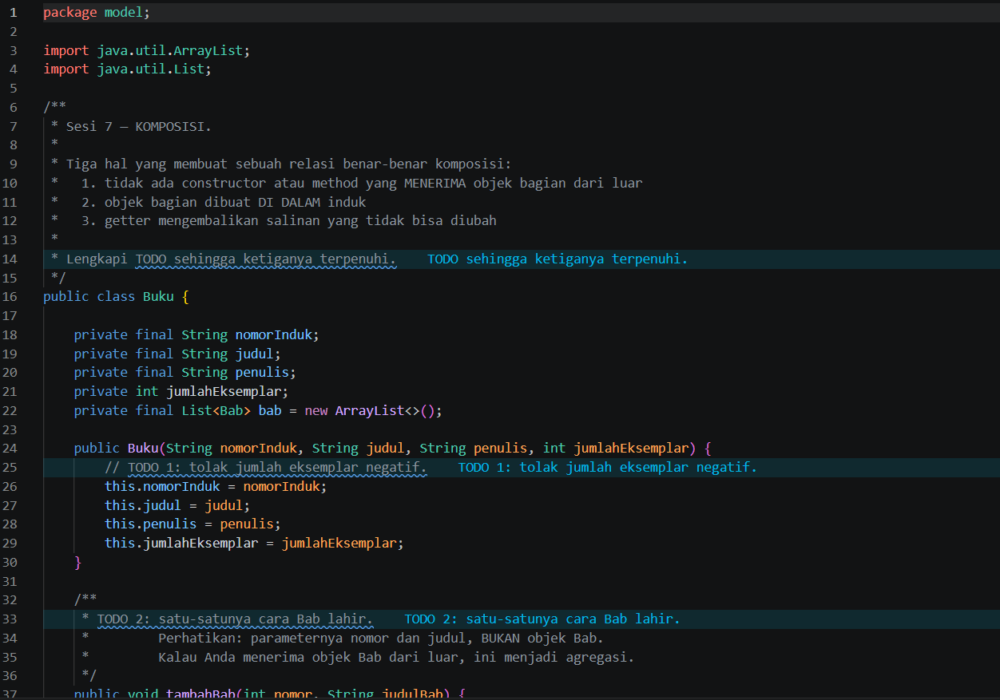
- **After**  : 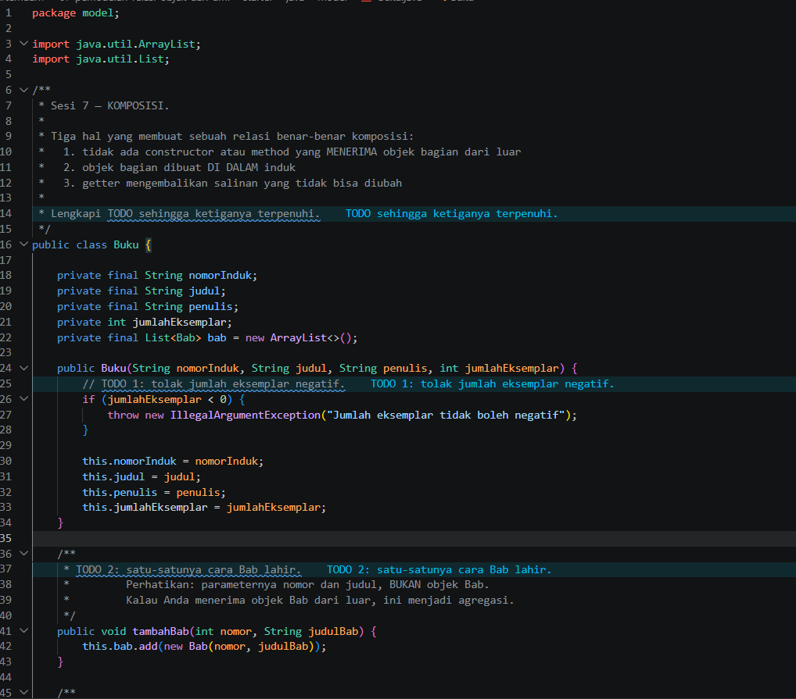

### 1.3. File: `Jurusan.java`

**Penjelasan Kode:**
> Kelas model yang menyimpan informasi jurusan (`kodeJurusan` dan `namaJurusan`). Digunakan sebagai atribut dalam kelas `Anggota` untuk mengimplementasikan hubungan **Asosiasi**.

**Bukti Eksekusi (Screenshot):**
- **Before** : 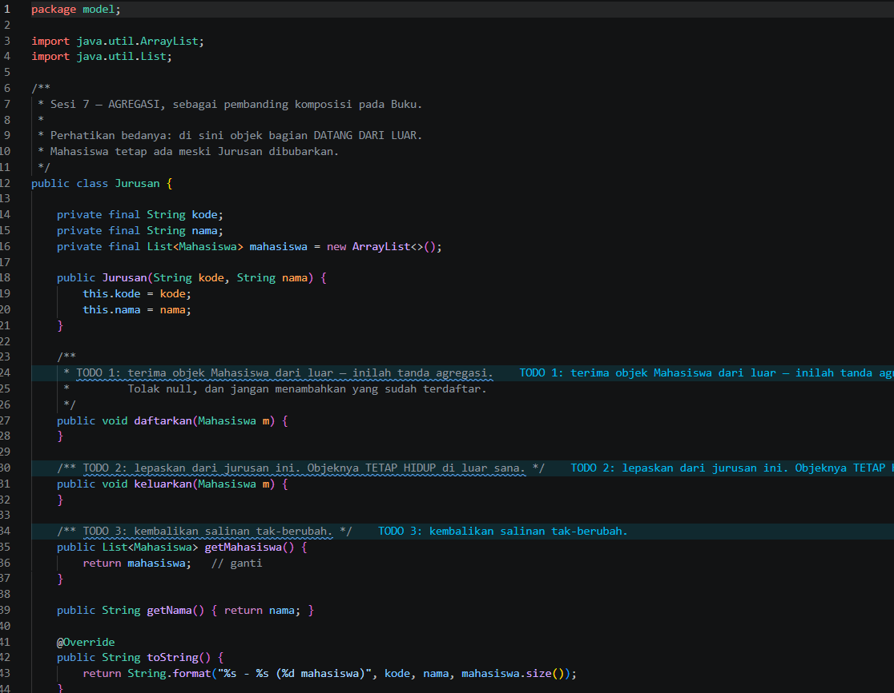
- **After**  : 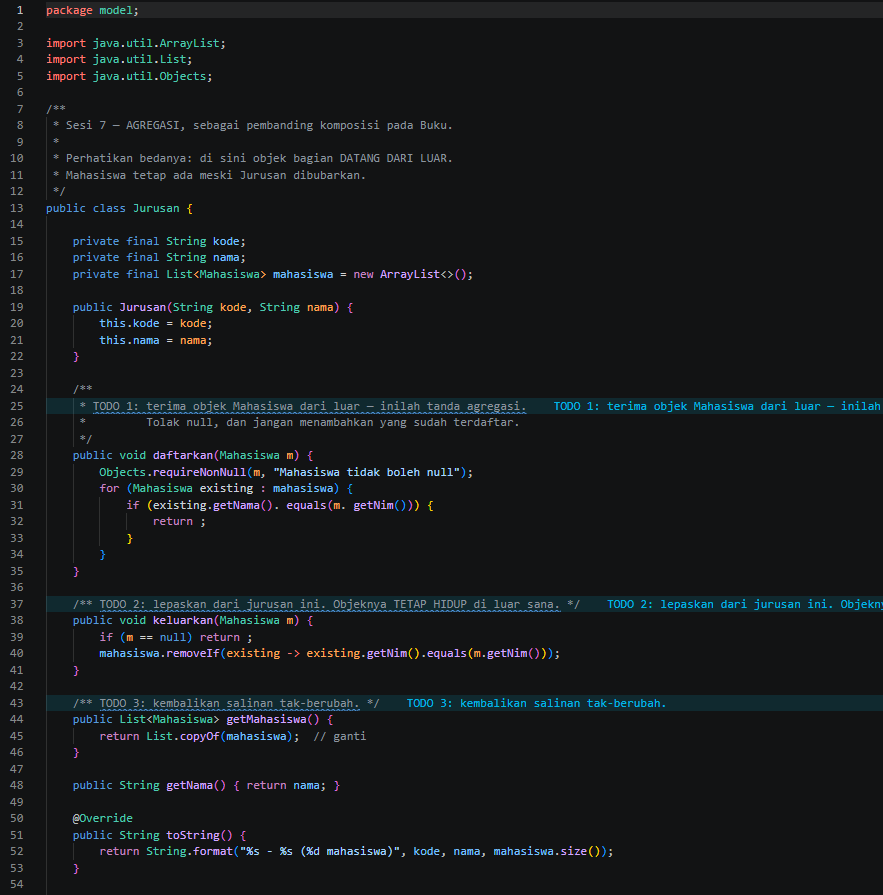

### 1.4. File: `PerpustakaanService.java`

**Penjelasan Kode:**
> Kelas layanan utama yang mengelola logika bisnis perpustakaan. Menerapkan hubungan **Komposisi** (mengelola koleksi `Buku`), **Agregasi** (mengelola daftar `Anggota`), serta **Dependensi** pada kelas `TransaksiPeminjaman` saat memproses transaksi peminjaman dan pengembalian.

**Bukti Eksekusi (Screenshot):**
- **Before** : 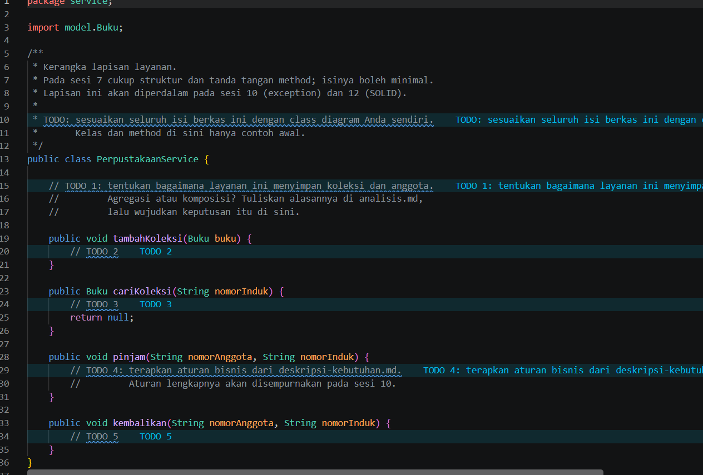
- **After**  : 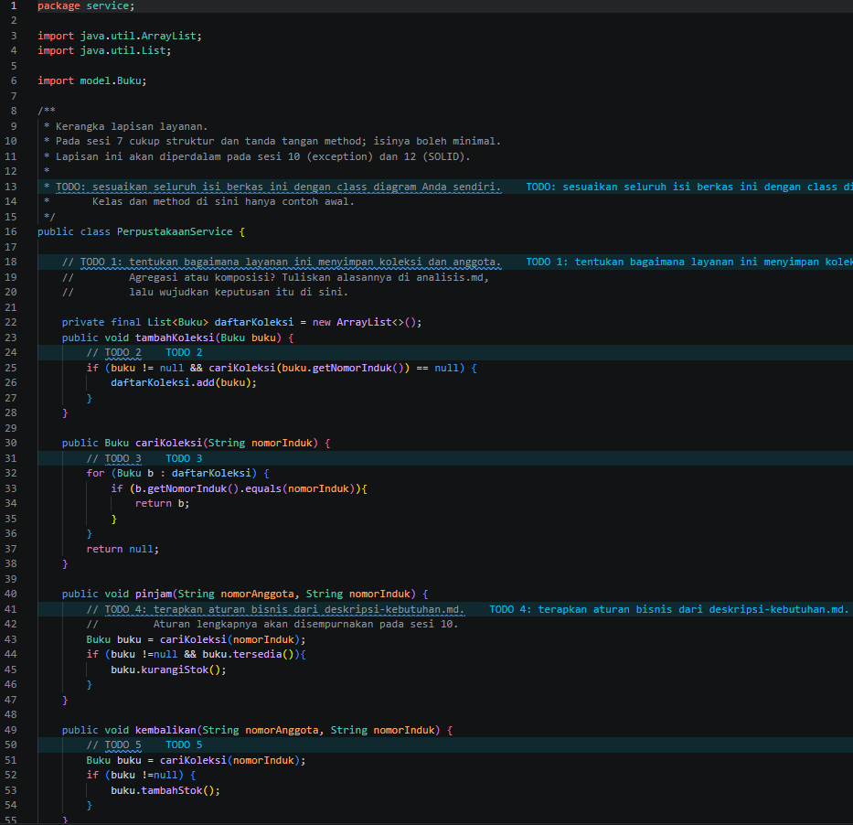

### Output

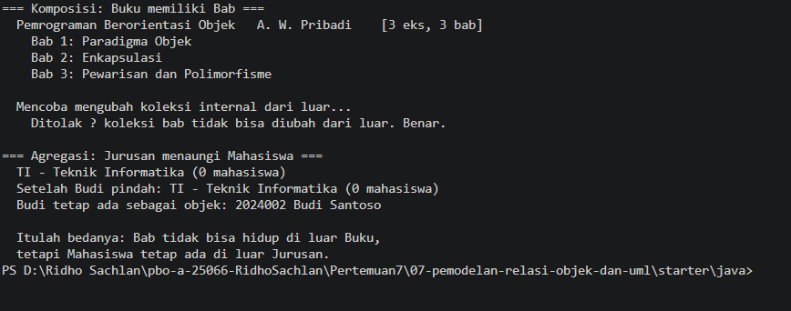

---

## 2. Implementasi PHP

### 2.1. File: `main.php`

**Penjelasan Kode:**
> Berkas utama untuk menjalankan simulasi program berbasis PHP. Menginstansiasi objek `PerpustakaanService`, menambahkan data buku, mendaftarkan anggota jurusan, serta menjalankan pengujian transaksi peminjaman buku beserta penanganan exception.

**Bukti Eksekusi (Screenshot):**
- **Before** : 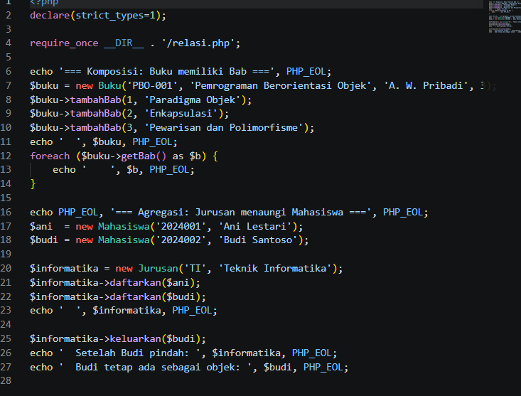
- **After**  : 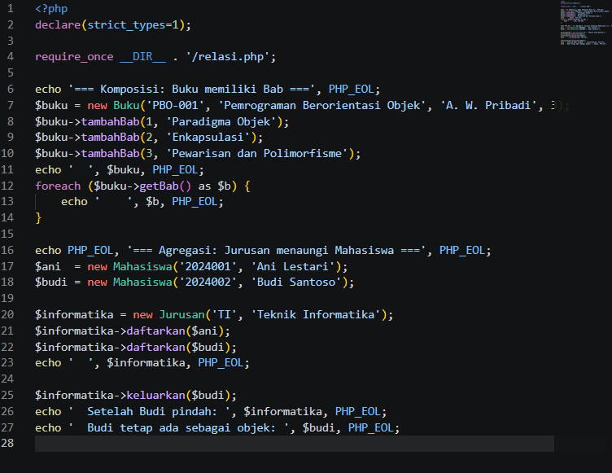

### 2.2. File: `relasi.php`

**Penjelasan Kode:**
> Berkas struktur domain yang mendefinisikan seluruh kelas utama (`Jurusan`, `Anggota`, `Buku`, `TransaksiPeminjaman`, dan `PerpustakaanService`) beserta relasinya dalam PHP. Menggunakan fitur Type Hinting, Property Promotion, dan enkapsulasi untuk memastikan keabsahan relasi antar objek.

**Bukti Eksekusi (Screenshot):**
- **Before** : 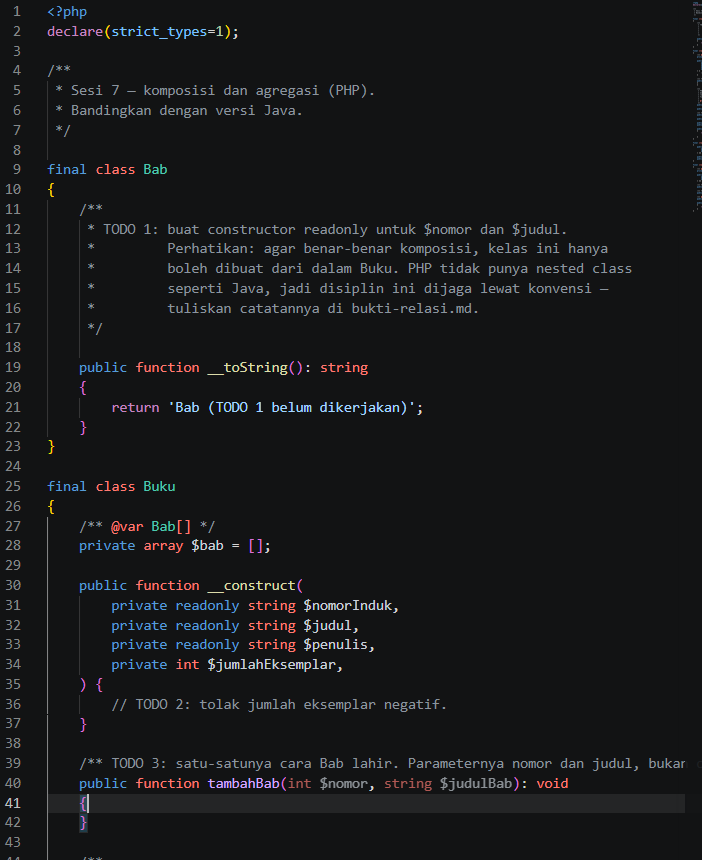
- **After**  : 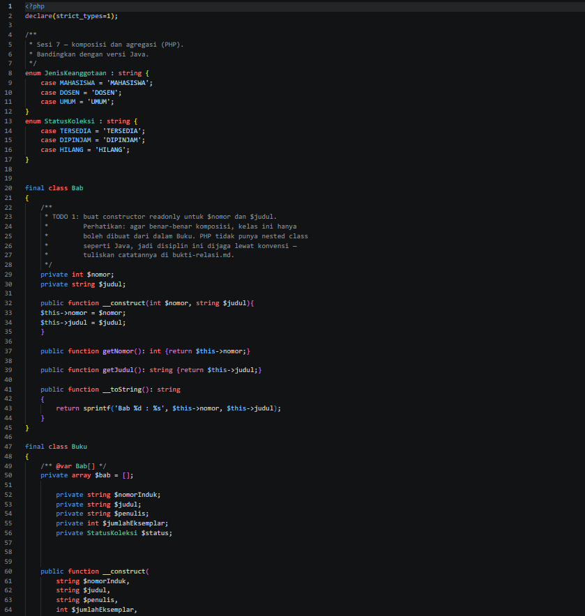

### Output

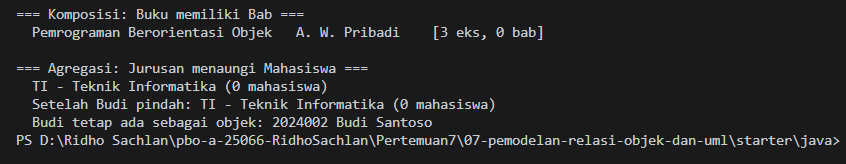

---

## 3. Kesimpulan

Pemodelan relasi objek memungkinkan pengembangan sistem yang terstruktur dan mencerminkan domain dunia nyata dengan akurat. Penggunaan Komposisi memastikan keterikatan umur objek yang kuat (seperti perpustakaan dan katalog bukunya), sementara Agregasi memberikan fleksibilitas hubungan yang lebih longgar (seperti perpustakaan dan anggotanya). Baik dalam Java maupun PHP, penerapan enkapsulasi dan relasi objek yang tepat membantu menjaga konsistensi data serta mempermudah pemeliharaan kode (*maintainability*).