# LAPORAN PRAKTIKUM PEMROGRAMAN BERBASIS OBJEK

| Informasi Praktikan | Keterangan |
| :--- | :--- |
| **Nama** | Ridho Sachlan |
| **NPM** | 4525210066 |
| **Kelas** | A |
| **Mata Kuliah** | Pemrograman Berbasis Objek (PBO) |
| **Pertemuan** | 09 - Package, Namespace, dan Build Tool |
| **Tanggal** | Kamis, 29 Oktober 2026 |

---

## 1. Implementasi Java

Proyek Java direstrukturisasi menjadi proyek **Maven** dengan package `id.ac.univpancasila.perpustakaan` (sub-package `model`, `service`, `util`). Dependensi eksternal yang dipakai adalah **ascii-table** (`com.github.freva:ascii-table:1.8.0`).

### 1.1. File: `App.java`

**Penjelasan Kode:**
> Titik masuk (entry point) aplikasi Sistem Perpustakaan yang berada di package `id.ac.univpancasila.perpustakaan`. Kelas ini mengimpor kelas antar-package (`model`, `service`, `util`) dan pustaka eksternal `AsciiTable`. Alurnya: menambah koleksi `Buku` beserta `Bab` (komposisi), mendaftarkan `Anggota`, mensimulasikan peminjaman dan pengembalian terlambat melalui `PerpustakaanService`, lalu menampilkan tabel koleksi, tabel transaksi, dan rincian denda memakai `AsciiTable.getTable(...)`.

**Bukti Eksekusi (Screenshot):**
- **Source code**: 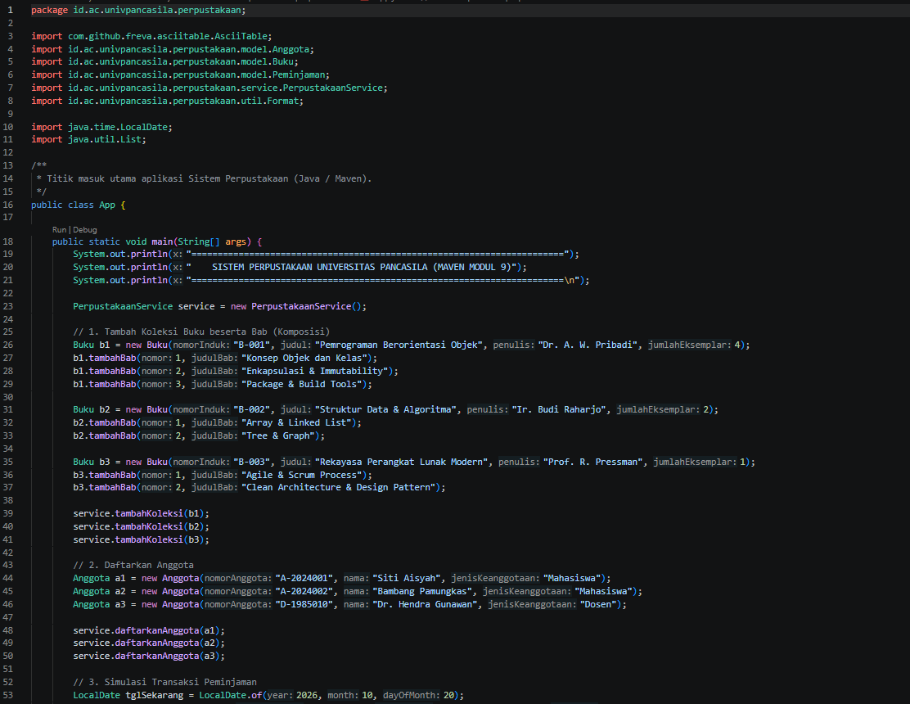

### 1.2. File: `Buku.java`

**Penjelasan Kode:**
> Entitas buku pada package `...perpustakaan.model`. Menerapkan enkapsulasi (atribut `private final`) dan relasi **komposisi** terhadap kelas dalam `Bab`, yang hanya bisa dibuat lewat `tambahBab()`. Menyediakan pengelolaan stok (`tersedia()`, `kurangiStok()`, `tambahStok()`) serta validasi jumlah eksemplar tidak boleh negatif.

**Bukti Eksekusi (Screenshot):**
- **Source code**: 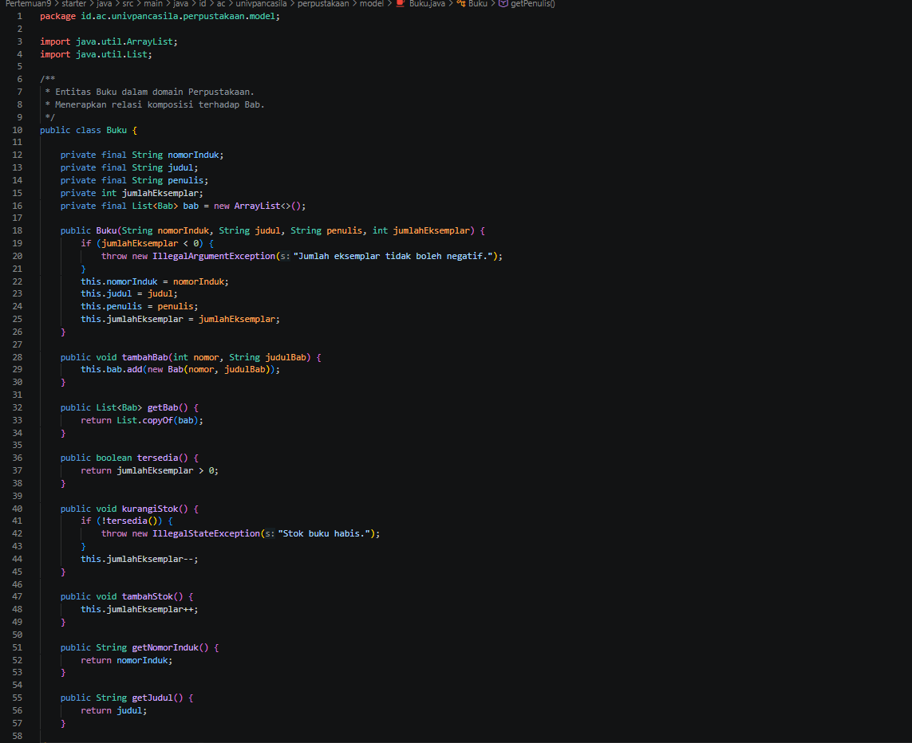

### 1.3. File: `Anggota.java`

**Penjelasan Kode:**
> Entitas anggota perpustakaan pada package `...perpustakaan.model`. Menyimpan `nomorAnggota`, `nama`, dan `jenisKeanggotaan` (Mahasiswa/Dosen) secara immutable, dengan validasi bahwa nomor anggota dan nama tidak boleh kosong.

**Bukti Eksekusi (Screenshot):**
- **Source code**: 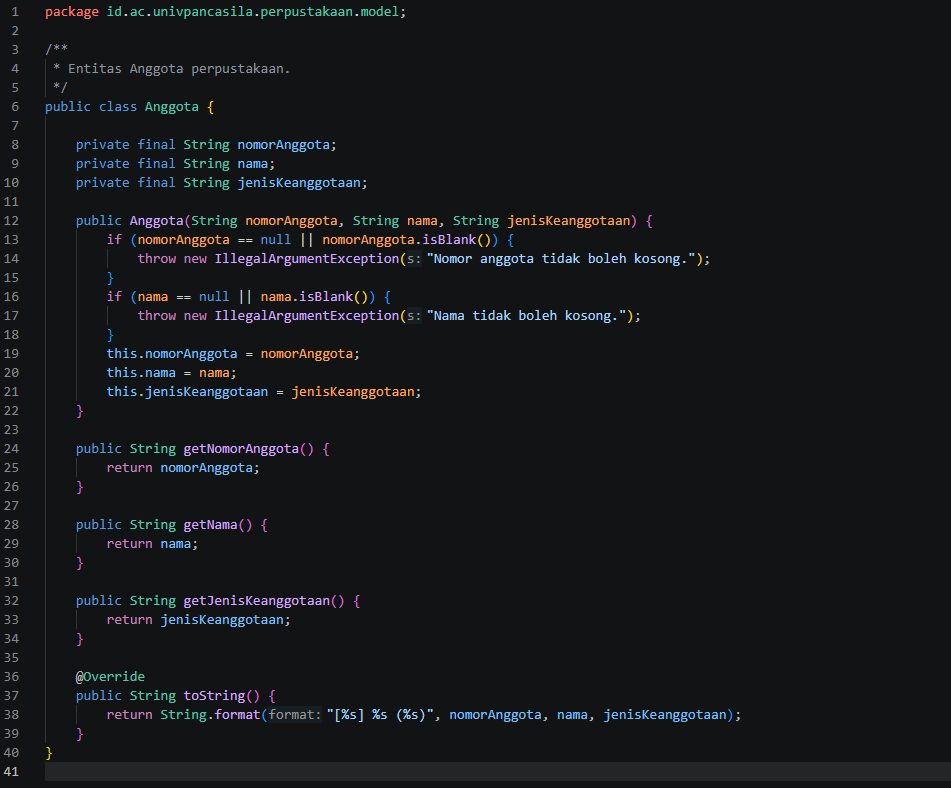

### 1.4. File: `Peminjaman.java`

**Penjelasan Kode:**
> Entitas transaksi peminjaman pada package `...perpustakaan.model`. Menghubungkan `Anggota` dan `Buku`, menghitung `tanggalJatuhTempo` dari `tanggalPinjam` ditambah `lamaHari`, serta mencatat `tanggalKembali` (bernilai `null` selama buku belum dikembalikan).

**Bukti Eksekusi (Screenshot):**
- **Source code**: 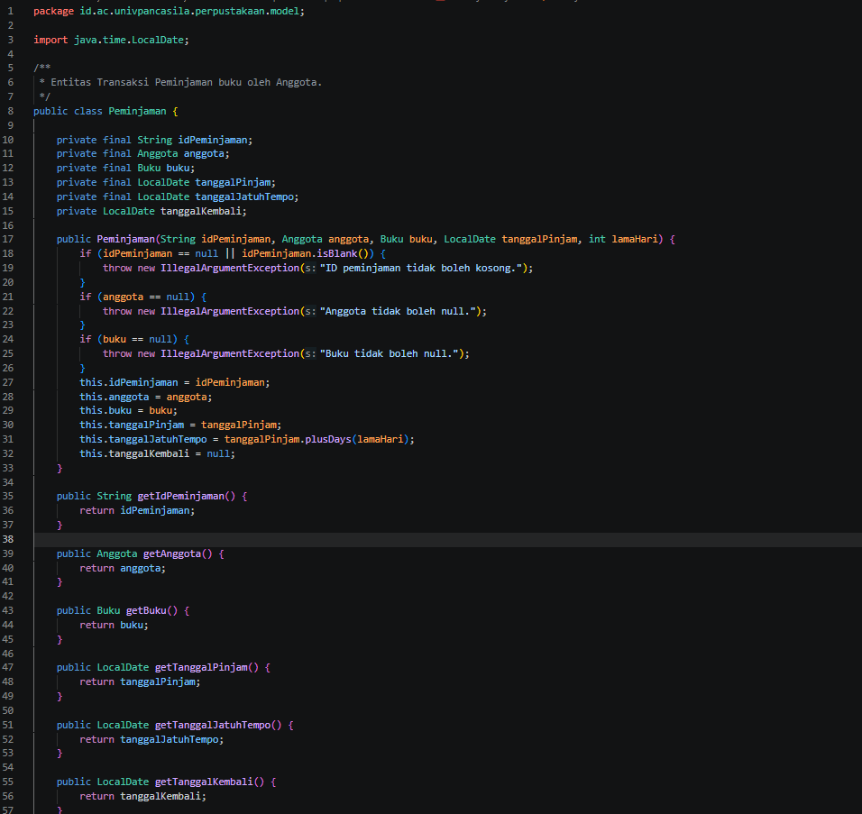

### 1.5. File: `PerpustakaanService.java`

**Penjelasan Kode:**
> Lapisan layanan pada package `...perpustakaan.service` yang berisi logika bisnis: mengelola koleksi dan anggota, memproses `pinjam()` (validasi anggota, buku, stok, dan batas maksimal 3 pinjaman aktif), `kembalikan()`, serta `hitungDenda()` dengan tarif Rp1.000/hari untuk mahasiswa dan Rp500/hari untuk dosen. Kelas ini mengimpor kelas dari package `model`.

**Bukti Eksekusi (Screenshot):**
- **Source code**: 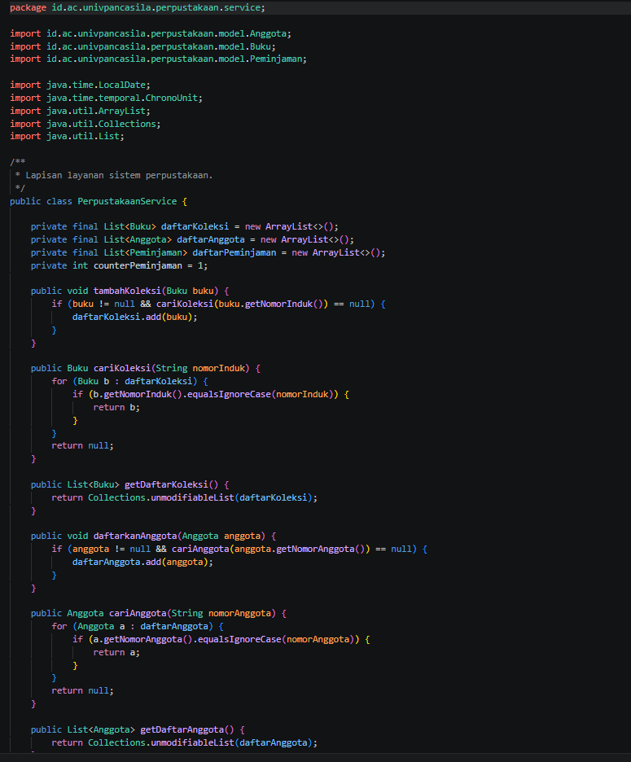

### 1.6. File: `Format.java`

**Penjelasan Kode:**
> Kelas utilitas pada package `...perpustakaan.util` (konstruktor `private`, kelas `final`) untuk memformat nilai Rupiah (`formatRupiah`) dan tanggal berbahasa Indonesia (`formatTanggal`) dengan locale `id-ID`.

**Bukti Eksekusi (Screenshot):**
- **Source code**: 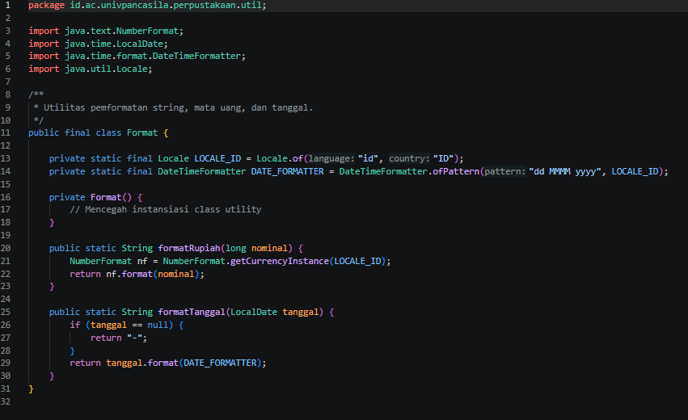

### 1.7. File: `pom.xml`

**Penjelasan Kode:**
> Berkas konfigurasi Maven. Berisi koordinat proyek (`groupId` = `id.ac.univpancasila.perpustakaan`, `artifactId` = `perpustakaan`, `version` = `1.0.0`), `maven.compiler.release` = 25, dependensi eksternal `ascii-table 1.8.0`, dan plugin `exec-maven-plugin` agar program dapat dijalankan dengan `mvn exec:java`.

### Output

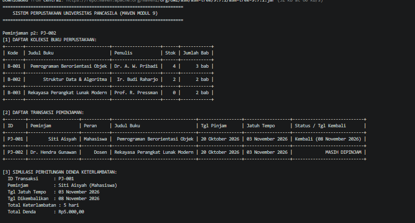

---

## 2. Implementasi PHP

Proyek PHP direstrukturisasi menjadi proyek **Composer** dengan namespace `Perpustakaan\` yang dipetakan ke folder `src/` melalui autoload **PSR-4**. Dependensi eksternal yang dipakai adalah **nesbot/carbon** untuk pengelolaan tanggal.

### 2.1. File: `main.php`

**Penjelasan Kode:**
> Titik masuk aplikasi PHP. Seluruh `require_once` manual dihapus dan diganti satu baris `require __DIR__ . '/vendor/autoload.php'` sehingga kelas dimuat otomatis oleh autoload PSR-4. Program membuat koleksi buku, mendaftarkan anggota, mensimulasikan peminjaman dengan `Carbon`, pengembalian terlambat 5 hari, lalu mencetak daftar buku, daftar transaksi, dan rincian denda.

**Bukti Eksekusi (Screenshot):**
- **Source code**: 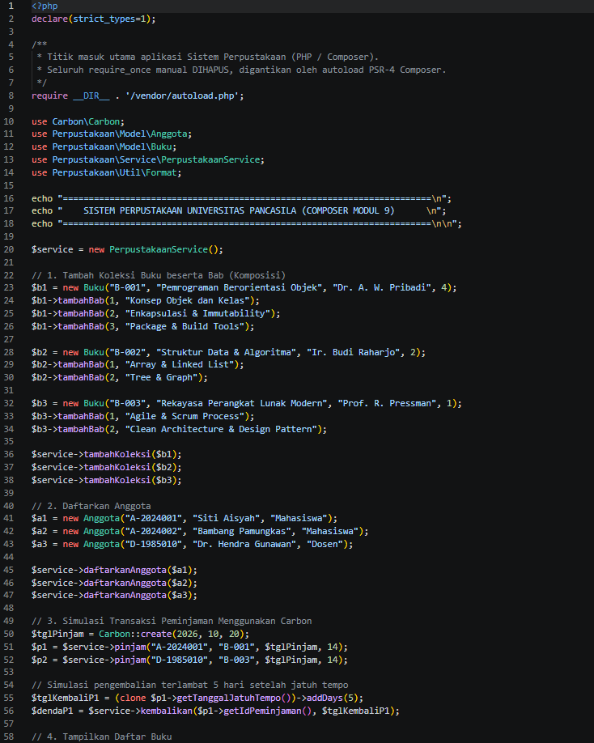

### 2.2. File: `Buku.php`

**Penjelasan Kode:**
> Entitas buku pada namespace `Perpustakaan\Model`. Menerapkan komposisi terhadap `Bab` dan pengelolaan stok eksemplar.

**Bukti Eksekusi (Screenshot):**
- **Source code**: 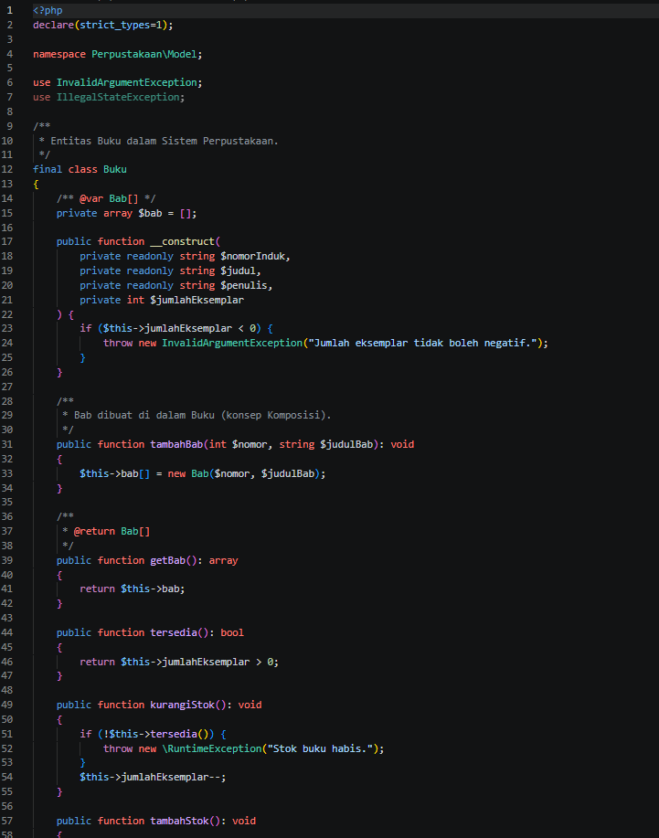

### 2.3. File: `Bab.php`

**Penjelasan Kode:**
> Kelas `final` pada namespace `Perpustakaan\Model` yang merepresentasikan bab dalam sebuah buku (`nomor` dan `judul`) memakai constructor property promotion `readonly`. Bagian dari relasi komposisi dengan `Buku`.

**Bukti Eksekusi (Screenshot):**
- **Source code**: 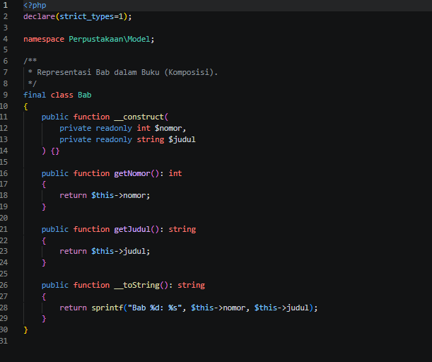

### 2.4. File: `Anggota.php`

**Penjelasan Kode:**
> Entitas anggota perpustakaan pada namespace `Perpustakaan\Model` dengan properti `readonly` dan validasi nomor anggota serta nama tidak boleh kosong (melempar `InvalidArgumentException`).

**Bukti Eksekusi (Screenshot):**
- **Source code**: 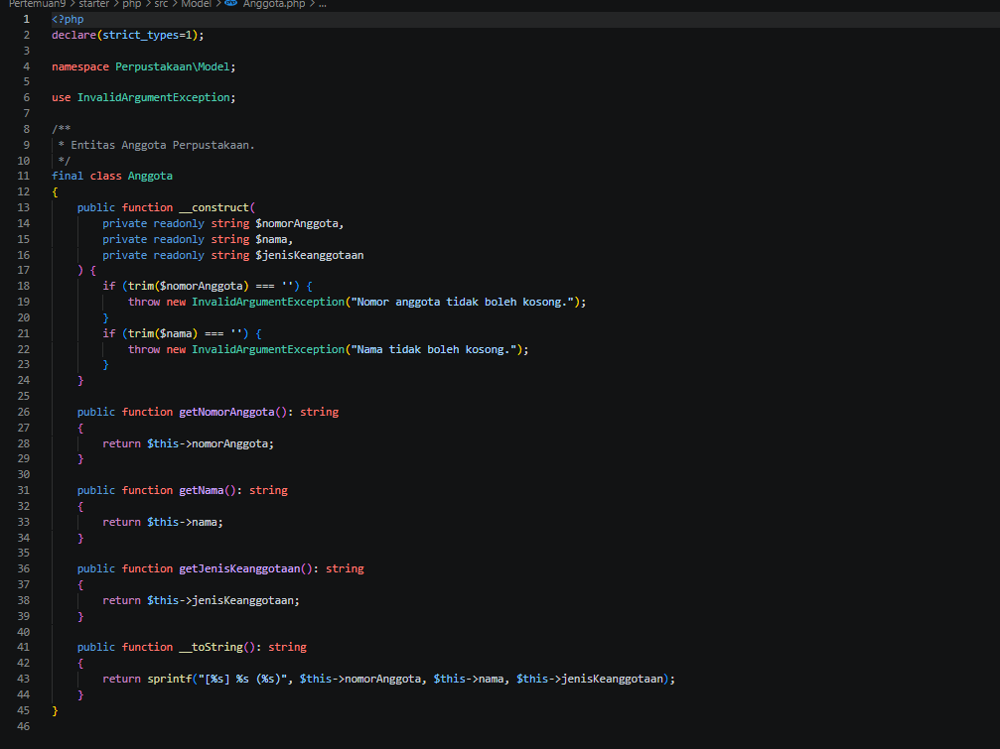

### 2.5. File: `Peminjaman.php`

**Penjelasan Kode:**
> Entitas transaksi peminjaman pada namespace `Perpustakaan\Model`. Memakai pustaka eksternal `Carbon` untuk menghitung tanggal jatuh tempo (`addDays`), bukan aritmetika tanggal manual.

**Bukti Eksekusi (Screenshot):**
- **Source code**: 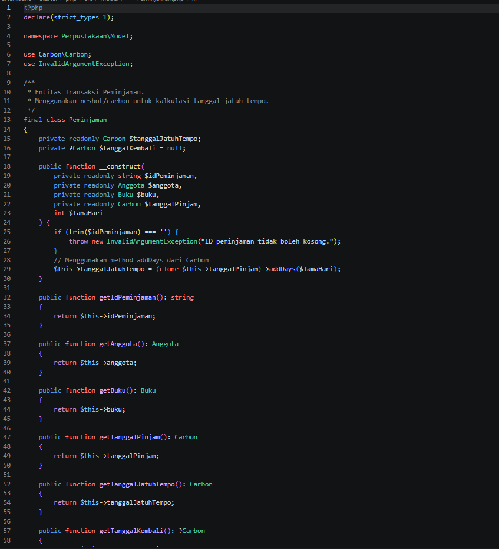

### 2.6. File: `PerpustakaanService.php`

**Penjelasan Kode:**
> Lapisan layanan pada namespace `Perpustakaan\Service`. Memproses peminjaman (validasi anggota, buku, stok, batas 3 pinjaman aktif), pengembalian, dan perhitungan denda keterlambatan memakai `Carbon::diffInDays()`.

**Bukti Eksekusi (Screenshot):**
- **Source code**: 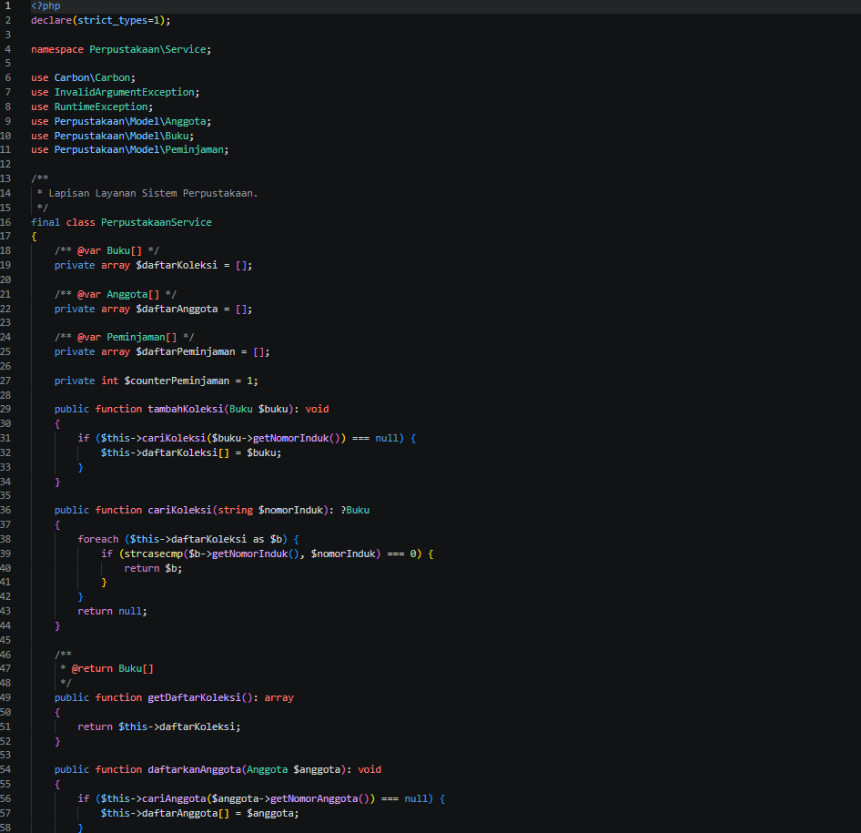

### 2.7. File: `Format.php`

**Penjelasan Kode:**
> Kelas utilitas pada namespace `Perpustakaan\Util` untuk memformat nilai Rupiah (`formatRupiah`) dan tanggal berlokal Indonesia (`formatTanggal`) memakai `Carbon`.

**Bukti Eksekusi (Screenshot):**
- **Source code**: 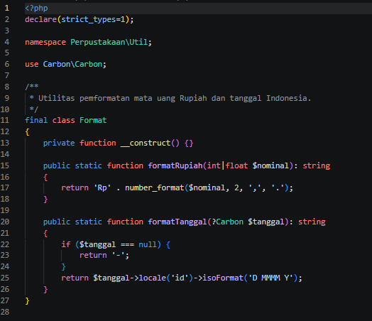

### 2.8. File: `composer.json`

**Penjelasan Kode:**
> Berkas konfigurasi Composer. Memetakan namespace `Perpustakaan\` ke folder `src/` pada bagian `autoload.psr-4`, serta mendeklarasikan dependensi `nesbot/carbon`. Berkas `composer.lock` ikut di-commit agar versi dependensi sama di semua mesin.

### Output

**Output Program:**

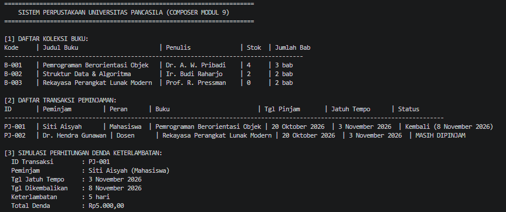

---

## 3. Kesimpulan

Pada praktikum ini proyek Sistem Perpustakaan direstrukturisasi menjadi proyek Maven (Java) dan Composer (PHP). Pada Java, baris `package` di setiap berkas harus sama persis dengan jalur foldernya (`src/main/java/id/ac/univpancasila/perpustakaan/...`), dan kelas antar-package dipakai melalui `import`. Pada PHP, namespace `Perpustakaan\` dipetakan ke folder `src/` oleh autoload PSR-4, sehingga seluruh `require_once` manual cukup digantikan satu baris `vendor/autoload.php`.

